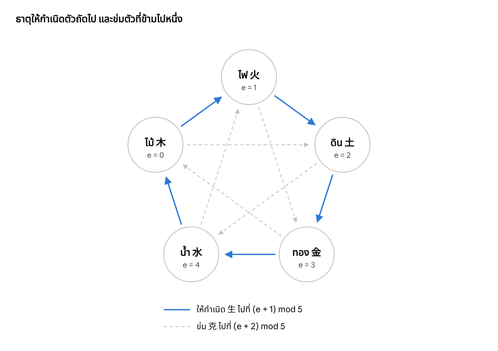
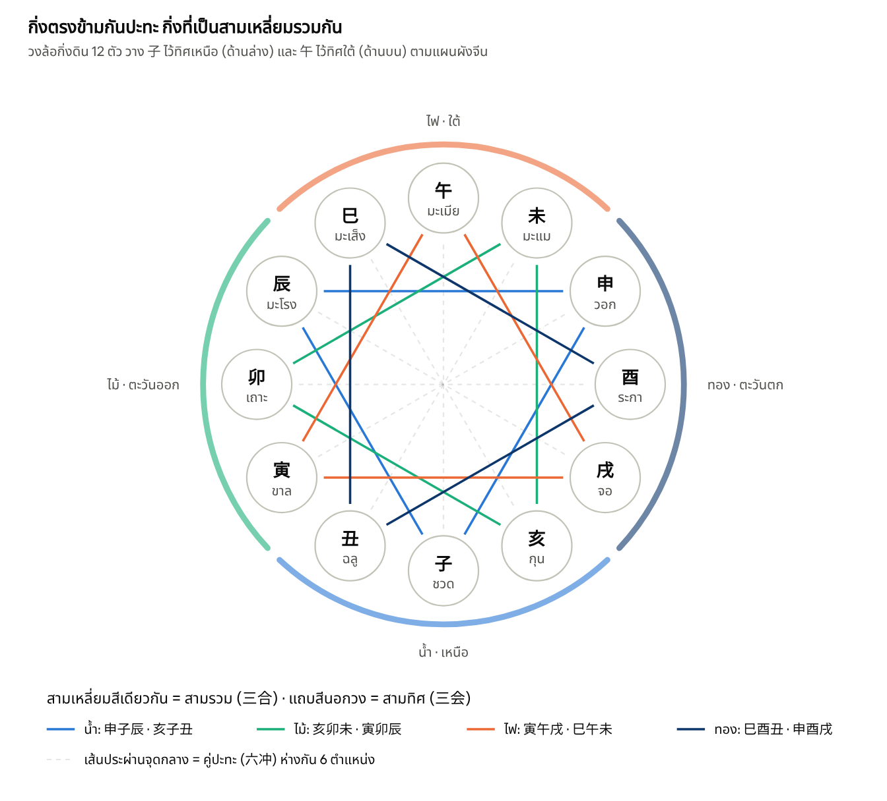
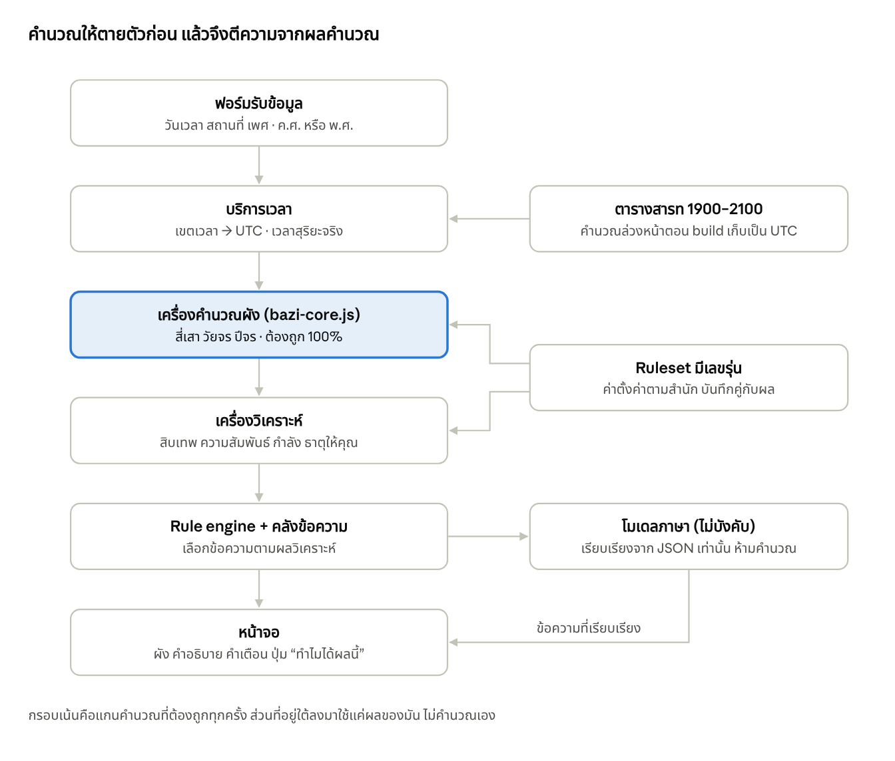

# ตำราปาจื้อ (八字) ฉบับนักพัฒนาแอป

ฉบับ 10 ตุลาคม 2026 · ไลบรารีประกอบตำราอยู่ที่ [src/bazi-core.js](../src/bazi-core.js)

## บทนำ: ปาจื้อในมุมของนักพัฒนา

ปาจื้อ (八字 แปดอักษร) แปลงเวลาเกิดเป็นอักษร 8 ตัว เรียงเป็น 4 เสา คือ ปี เดือน วัน ยาม แต่ละเสามีก้านฟ้า 1 ตัวอยู่บนและกิ่งดิน 1 ตัวอยู่ล่าง จากนั้นอ่านดวงจากสมดุลของธาตุทั้งห้ารอบ "เจ้าวัน" ซึ่งแทนตัวเจ้าชะตา

แอปที่ดีต้องแยกงานเป็นสามชั้น เพราะแต่ละชั้นทดสอบได้ไม่เท่ากัน

| ชั้น | ทำอะไร | ทดสอบได้แค่ไหน |
| --- | --- | --- |
| คำนวณ | สี่เสา ก้านแฝง วัยจร ปีจร | ต้องถูก 100% ตรวจกับปฏิทินดาราศาสตร์ได้ |
| วิเคราะห์ | สิบเทพ รวม/ปะทะ กำลังเจ้าวัน ธาตุให้คุณ | ถูกตามกฎของสำนักที่เลือก |
| ตีความ | คำทำนายนิสัย การงาน ความรัก โชคลาภ | ทดสอบด้วยโค้ดไม่ได้ ต้องให้ผู้รู้ตรวจ |

ลำดับการทำงานของแอป

1. รับข้อมูล: วันเวลาเกิด สถานที่เกิด (เพื่อรู้ไทม์โซนและลองจิจูด) และเพศ
2. แปลงเวลา: ได้เวลาสากล (UTC) สำหรับเสาปีและเดือน และเวลาท้องถิ่นสำหรับเสาวันและยาม
3. คำนวณสี่เสา (บทที่ 6)
4. ขยายข้อมูล: ก้านแฝง สิบเทพ สิบสองวงจรชีวิต นาอิน ช่องว่าง
5. หาความสัมพันธ์ระหว่างอักษร: รวม ปะทะ ทำร้าย ลงโทษ
6. ประเมินกำลังเจ้าวัน แล้วหาธาตุให้คุณ–ให้โทษและโครงสร้างดวง
7. คำนวณวัยจร 10 ปี ปีจร เดือนจร วันจร
8. ใส่ดาวพิเศษ (神煞)
9. สร้างคำทำนายจากกฎและคลังข้อความ

ตำรานี้ยึดสำนักจื่อผิง (子平) ซึ่งเป็นกระแสหลัก จุดที่สำนักเห็นต่างกันจะระบุไว้ ให้ทำเป็นค่าตั้งค่า (setting) ในแอป

**สัญลักษณ์ที่ใช้ทั้งเล่ม** ทุกตารางใช้ดัชนีเริ่มที่ 0 เพื่อนำไปเขียนโค้ดได้ทันที

- ก้านฟ้า s: 0–9 โดย 甲 = 0
- กิ่งดิน b: 0–11 โดย 子 = 0
- ธาตุ e: ไม้ 0 · ไฟ 1 · ดิน 2 · ทอง 3 · น้ำ 4
- mod หมายถึงเศษที่เป็นบวกเสมอ เช่น (−1) mod 12 = 11 ใน JavaScript ต้องเขียน `((x % n) + n) % n`

ปาจื้อเป็นศาสตร์ความเชื่อ ไม่มีหลักฐานทางวิทยาศาสตร์ว่าทำนายชีวิตได้ แอปจึงควรวางตัวเป็นเครื่องมือบันเทิงและสะท้อนตัวเอง (บทที่ 18)

## 1. หยินหยางและธาตุทั้งห้า

ธาตุทั้งห้าสัมพันธ์กันสองแบบ คือให้กำเนิดและข่ม ทั้งสองแบบเขียนเป็นสูตรเดียวได้ด้วยผลต่างของดัชนีธาตุแบบ mod 5

**หยินหยาง** อักษรทุกตัวมีขั้ว หยางคือพลังเปิด ขยาย เคลื่อนไหว หยินคือพลังรับ เก็บ นิ่ง ในโค้ด ก้านฟ้าเป็นหยางเมื่อ s เป็นเลขคู่ ส่วนกิ่งดินมีข้อยกเว้นที่ต้องระวัง (บทที่ 3)

**ธาตุทั้งห้า (五行) และสิ่งที่เชื่อมโยง** ใช้ทำฟีเจอร์สีมงคล ทิศ และตัวเลขได้

| e | ธาตุ | ฤดู | ทิศ | สี | อวัยวะ (แพทย์จีน) | เลข (河图) |
| --- | --- | --- | --- | --- | --- | --- |
| 0 | ไม้ 木 mù | ใบไม้ผลิ | ตะวันออก | เขียว | ตับ ถุงน้ำดี | 3, 8 |
| 1 | ไฟ 火 huǒ | ร้อน | ใต้ | แดง ม่วง ชมพู | หัวใจ ลำไส้เล็ก | 2, 7 |
| 2 | ดิน 土 tǔ | 18 วันท้ายทุกฤดู | กลาง | เหลือง น้ำตาล | ม้าม กระเพาะ | 5, 10 |
| 3 | ทอง 金 jīn | ใบไม้ร่วง | ตะวันตก | ขาว เงิน ทอง | ปอด ลำไส้ใหญ่ | 4, 9 |
| 4 | น้ำ 水 shuǐ | หนาว | เหนือ | ดำ น้ำเงิน | ไต กระเพาะปัสสาวะ | 1, 6 |

คอลัมน์อวัยวะใช้เป็นสีสันของคำทำนายได้เท่านั้น ห้ามใช้ให้คำแนะนำทางการแพทย์

**วงจรให้กำเนิด (相生)** ไม้ → ไฟ → ดิน → ทอง → น้ำ → ไม้ คือดัชนีถัดไป (e + 1) mod 5

**วงจรข่ม (相克)** ไม้ → ดิน → น้ำ → ไฟ → ทอง → ไม้ คือข้ามไปหนึ่งตัว (e + 2) mod 5



เส้นทึบรอบนอกคือวงจรให้กำเนิด เส้นประรูปดาวด้านในคือวงจรข่ม ทุกธาตุให้กำเนิดธาตุถัดไปตามเข็มนาฬิกา และข่มธาตุที่ข้ามไปหนึ่งตำแหน่ง

**สูตรความสัมพันธ์** ให้ d = (e\_B − e\_A) mod 5 เมื่อมองจากธาตุ A ไปยังธาตุ B

| d | ความหมาย | ตัวอย่างเมื่อ A = ไม้ |
| --- | --- | --- |
| 0 | ธาตุเดียวกัน (同) | B = ไม้ |
| 1 | A ให้กำเนิด B (我生) | B = ไฟ |
| 2 | A ข่ม B (我克) | B = ดิน |
| 3 | B ข่ม A (克我) | B = ทอง |
| 4 | B ให้กำเนิด A (生我) | B = น้ำ |

ตารางนี้คือรากของสิบเทพ (บทที่ 8) และการหาธาตุให้คุณ (บทที่ 12)

**กำลังธาตุตามฤดู (旺相休囚死)** ธาตุเดียวกันมีพลังต่างกันตามเดือนเกิด ฤดูของเดือนใช้ธาตุของกิ่งเดือนได้เลย ให้ d = (e − e\_เดือน) mod 5 แล้วอ่านผล d = 0 รุ่ง (旺) · 1 รอง (相) · 4 พัก (休) · 3 ถูกขัง (囚) · 2 ดับ (死)

| ฤดู (กิ่งเดือน) | 旺 รุ่ง | 相 รอง | 休 พัก | 囚 ถูกขัง | 死 ดับ |
| --- | --- | --- | --- | --- | --- |
| ใบไม้ผลิ (寅 卯) | ไม้ | ไฟ | น้ำ | ทอง | ดิน |
| ร้อน (巳 午) | ไฟ | ดิน | ไม้ | น้ำ | ทอง |
| ปลายฤดู (辰 未 戌 丑) | ดิน | ทอง | ไฟ | ไม้ | น้ำ |
| ใบไม้ร่วง (申 酉) | ทอง | น้ำ | ดิน | ไฟ | ไม้ |
| หนาว (亥 子) | น้ำ | ไม้ | ทอง | ดิน | ไฟ |

บทที่ 11 ใช้ตารางนี้เป็นตัวคูณน้ำหนักตอนประเมินกำลังเจ้าวัน

## 2. ก้านฟ้า 10 (天干)

ก้านฟ้าคือธาตุทั้งห้าแยกเป็นขั้วหยางและหยิน ได้ 10 ตัว ธาตุและขั้วคำนวณจากดัชนีได้ทันที คือธาตุ = ⌊s ÷ 2⌋ และเป็นหยางเมื่อ s เป็นเลขคู่

| s | อักษร | อ่านแบบไทย | ธาตุ · ขั้ว | ภาพเปรียบ | นิสัยเด่นเมื่อเป็นเจ้าวัน |
| --- | --- | --- | --- | --- | --- |
| 0 | 甲 jiǎ | กะ | ไม้หยาง | ต้นไม้ใหญ่ | ตรง มีหลักการ ชอบนำ ดื้อเมื่อถูกบังคับ |
| 1 | 乙 yǐ | อิก | ไม้หยิน | ไม้เลื้อย ดอกไม้ | ยืดหยุ่น ปรับตัวเก่ง อาศัยเครือข่าย |
| 2 | 丙 bǐng | เปี้ย | ไฟหยาง | ดวงอาทิตย์ | เปิดเผย ใจกว้าง กระตือรือร้น |
| 3 | 丁 dīng | เต็ง | ไฟหยิน | เทียน ตะเกียง | ละเอียด อบอุ่น ช่างสังเกต |
| 4 | 戊 wù | โบ่ว | ดินหยาง | ภูเขา | มั่นคง หนักแน่น เปลี่ยนใจยาก |
| 5 | 己 jǐ | กี้ | ดินหยิน | ดินสวน ดินนา | เลี้ยงดู ใส่ใจรายละเอียด |
| 6 | 庚 gēng | แก | ทองหยาง | ขวาน เหล็กกล้า | เด็ดขาด กล้า ตรงไปตรงมา |
| 7 | 辛 xīn | ซิง | ทองหยิน | อัญมณี | ประณีต รักภาพลักษณ์ อ่อนไหวต่อคำติ |
| 8 | 壬 rén | ยิ้ม | น้ำหยาง | ทะเล แม่น้ำ | ฉลาด คล่องตัว รักอิสระ |
| 9 | 癸 guǐ | กุ่ย | น้ำหยิน | ฝน น้ำค้าง | ช่างคิด อ่อนโยน มีจินตนาการ |

คำอ่านแบบไทยเป็นเสียงแต้จิ๋วที่พบในปฏิทินจีนฉบับไทย การสะกดต่างกันได้ ควรให้ผู้รู้ภาษาตรวจก่อนใช้เป็นข้อความในแอป

**การรวมของก้านฟ้า (天干五合)** ก้านที่ห่างกัน 5 ตำแหน่งดึงดูดกัน และอาจแปรเป็นธาตุใหม่

| คู่ | ธาตุที่แปรเป็น | ชื่อเรียกดั้งเดิม |
| --- | --- | --- |
| 甲 + 己 | ดิน | การรวมแห่งความยุติธรรม (中正之合) |
| 乙 + 庚 | ทอง | การรวมแห่งเมตตาและความชอบธรรม (仁义之合) |
| 丙 + 辛 | น้ำ | การรวมแห่งอำนาจ (威制之合) |
| 丁 + 壬 | ไม้ | การรวมแห่งราคะ (淫慝之合) |
| 戊 + 癸 | ไฟ | การรวมที่ไร้เมตตา (无情之合) |

สูตรคือ |a − b| = 5 และธาตุที่แปร = (min(a, b) + 2) mod 5

การรวมไม่ได้แปรธาตุทุกครั้ง เงื่อนไขที่ตำราส่วนใหญ่ใช้มีสามข้อ

1. สองก้านต้องอยู่ติดกัน (ปี–เดือน เดือน–วัน วัน–ยาม)
2. กิ่งเดือนต้องหนุนธาตุที่แปร เช่น 丁壬 แปรเป็นไม้ได้เมื่อเกิดในเดือนไม้
3. ต้องไม่มีก้านอื่นปะทะหรือแย่งรวม

เงื่อนไขไม่ครบให้แอปแสดงว่า "รวมแต่ไม่แปร" (合而不化) ซึ่งตีความว่าสองฝ่ายผูกมัดกันจนทำหน้าที่เดิมได้ไม่เต็มที่ เมื่อเจ้าวันถูกรวม ห้ามตีความว่าเจ้าวันแปรธาตุ เว้นแต่ผู้รู้ยืนยัน

**การปะทะของก้านฟ้า (天干相冲)** สี่คู่ที่ห่างกัน 6 ตำแหน่ง คือ 甲–庚 乙–辛 丙–壬 丁–癸 ส่วน 戊 และ 己 อยู่ศูนย์กลางจึงไม่มีคู่ปะทะ สูตรคือ |a − b| = 6

การปะทะสื่อถึงความขัดแย้งระหว่างเรื่องที่สองเสานั้นแทน (บทที่ 8 ตำแหน่งเสา) ถ้าเสาติดกันจะแรงกว่าเสาที่อยู่ห่างกัน

## 3. กิ่งดิน 12 (地支) และก้านแฝง

กิ่งดินบอกนักษัตร เดือน และยาม และแต่ละตัวซ่อนก้านฟ้า 1–3 ตัวไว้ข้างใน การวิเคราะห์ทุกขั้นที่ลึกกว่าการนับธาตุผิว ๆ ต้องใช้ก้านแฝงเหล่านี้

| b | อักษร | นักษัตร | ธาตุ | เดือนปาจื้อเริ่มที่ | ยาม | ก้านแฝง (หลัก · กลาง · เศษ) |
| --- | --- | --- | --- | --- | --- | --- |
| 0 | 子 zǐ | ชวด | น้ำ | 大雪 ราว 7 ธ.ค. | 23:00–00:59 | 癸 |
| 1 | 丑 chǒu | ฉลู | ดิน | 小寒 ราว 5 ม.ค. | 01:00–02:59 | 己 · 癸 · 辛 |
| 2 | 寅 yín | ขาล | ไม้ | 立春 ราว 4 ก.พ. | 03:00–04:59 | 甲 · 丙 · 戊 |
| 3 | 卯 mǎo | เถาะ | ไม้ | 惊蛰 ราว 6 มี.ค. | 05:00–06:59 | 乙 |
| 4 | 辰 chén | มะโรง | ดิน | 清明 ราว 5 เม.ย. | 07:00–08:59 | 戊 · 乙 · 癸 |
| 5 | 巳 sì | มะเส็ง | ไฟ | 立夏 ราว 5 พ.ค. | 09:00–10:59 | 丙 · 庚 · 戊 |
| 6 | 午 wǔ | มะเมีย | ไฟ | 芒种 ราว 6 มิ.ย. | 11:00–12:59 | 丁 · 己 |
| 7 | 未 wèi | มะแม | ดิน | 小暑 ราว 7 ก.ค. | 13:00–14:59 | 己 · 丁 · 乙 |
| 8 | 申 shēn | วอก | ทอง | 立秋 ราว 7 ส.ค. | 15:00–16:59 | 庚 · 壬 · 戊 |
| 9 | 酉 yǒu | ระกา | ทอง | 白露 ราว 8 ก.ย. | 17:00–18:59 | 辛 |
| 10 | 戌 xū | จอ | ดิน | 寒露 ราว 8 ต.ค. | 19:00–20:59 | 戊 · 辛 · 丁 |
| 11 | 亥 hài | กุน | น้ำ | 立冬 ราว 7 พ.ย. | 21:00–22:59 | 壬 · 甲 |

วันที่ในตารางเป็นค่าโดยประมาณ แอปต้องคำนวณเวลาสารทจริงทุกครั้ง (บทที่ 5) ช่วงเวลายามเป็นเวลาท้องถิ่น ส่วนจะใช้เวลานาฬิกาหรือเวลาสุริยะจริงดูบทที่ 7

**กับดักเรื่องขั้วหยินหยาง** ตามลำดับ กิ่งเลขคู่เป็นหยาง แต่สี่ตัวมีก้านหลักขั้วกลับกัน คือ 子 ใช้ 癸 (หยิน) · 午 ใช้ 丁 (หยิน) · 巳 ใช้ 丙 (หยาง) · 亥 ใช้ 壬 (หยาง) ตำราเรียกว่า "รูปหยาง ใช้หยิน" (体阳用阴) ตอนคิดสิบเทพของกิ่ง ให้ใช้ก้านหลักเสมอ อย่าใช้ขั้วตามลำดับ

**ก้านแฝง (藏干) ในรูปดัชนี** ใช้ได้ทันทีในโค้ด

```javascript
// ลำดับในแต่ละกิ่ง: [หลัก, กลาง, เศษ]
const HIDDEN_STEMS = [[9],[5,9,7],[0,2,4],[1],[4,1,9],[2,6,4],
                      [3,5],[5,3,1],[6,8,4],[7],[4,7,3],[8,0]];
// น้ำหนักเริ่มต้น: 1 ตัว = 100% · 2 ตัว = 70/30 · 3 ตัว = 60/30/10
const HIDDEN_WEIGHTS = { 1: [1], 2: [0.7, 0.3], 3: [0.6, 0.3, 0.1] };
```

น้ำหนัก 60/30/10 เป็นค่าที่แอปจำนวนมากใช้ ไม่ใช่ค่าตามตำราดั้งเดิม บางสำนักใช้ "ก้านแฝงผู้ครองวัน" (人元司令) ซึ่งเลือกก้านแฝงตามจำนวนวันที่ผ่านไปหลังสารทเริ่มเดือน ถ้าต้องการความละเอียดระดับนั้นให้ทำเป็นตัวเลือกขั้นสูง

**สามกลุ่มของกิ่งดิน** การจัดกลุ่มนี้ใช้ทั้งในดาวพิเศษและการตีความ

| กลุ่ม | กิ่ง | ลักษณะ | สูตร |
| --- | --- | --- | --- |
| สี่ทิศหลัก (四正) | 子 卯 午 酉 | ธาตุบริสุทธิ์ เป็นตำแหน่งดอกท้อ | b mod 3 = 0 |
| สี่เริ่มต้น (四生) | 寅 申 巳 亥 | จุดกำเนิดธาตุ เป็นตำแหน่งม้าเดินทาง | b mod 3 = 2 |
| สี่คลัง (四库) | 辰 戌 丑 未 | เก็บธาตุไว้: 辰 คลังน้ำ · 戌 คลังไฟ · 丑 คลังทอง · 未 คลังไม้ | b mod 3 = 1 |

## 4. หกสิบกะจื้อ (六十甲子) ชุดสิบ และนาอิน

ก้านฟ้า 10 และกิ่งดิน 12 เดินคู่กันทีละขั้น จึงวนครบรอบที่ 60 คู่ (ค.ร.น. ของ 10 กับ 12) วงรอบเดียวกันนี้ใช้นับทั้งปี เดือน วัน และยาม

- จากดัชนี n ไปเป็นอักษร: ก้าน = n mod 10 · กิ่ง = n mod 12
- จากอักษรกลับเป็นดัชนี: n = (6s − 5b) mod 60 ใช้ได้เมื่อ s กับ b เป็นคู่หรือคี่เหมือนกันเท่านั้น คู่ขั้วต่างกัน เช่น 甲丑 ไม่มีอยู่จริง แอปต้องปฏิเสธ

**ชุดสิบ (旬) และช่องว่าง (空亡)** ทุกชุดสิบเริ่มด้วย 甲 และใช้กิ่งไป 10 ตัว เหลือ 2 กิ่งที่ไม่ได้ใช้ ซึ่งคือช่องว่างของชุดนั้น

| ชุดสิบ | ดัชนี | สมาชิก | ช่องว่าง |
| --- | --- | --- | --- |
| 甲子 | 0–9 | 甲子 乙丑 丙寅 丁卯 戊辰 己巳 庚午 辛未 壬申 癸酉 | 戌 亥 |
| 甲戌 | 10–19 | 甲戌 乙亥 丙子 丁丑 戊寅 己卯 庚辰 辛巳 壬午 癸未 | 申 酉 |
| 甲申 | 20–29 | 甲申 乙酉 丙戌 丁亥 戊子 己丑 庚寅 辛卯 壬辰 癸巳 | 午 未 |
| 甲午 | 30–39 | 甲午 乙未 丙申 丁酉 戊戌 己亥 庚子 辛丑 壬寅 癸卯 | 辰 巳 |
| 甲辰 | 40–49 | 甲辰 乙巳 丙午 丁未 戊申 己酉 庚戌 辛亥 壬子 癸丑 | 寅 卯 |
| 甲寅 | 50–59 | 甲寅 乙卯 丙辰 丁巳 戊午 己未 庚申 辛酉 壬戌 癸亥 | 子 丑 |

สูตรช่องว่างของเสาที่มีก้าน s กิ่ง b: ให้ b₀ = (b − s) mod 12 แล้วช่องว่างคือ (b₀ + 10) mod 12 และ (b₀ + 11) mod 12 ส่วนใหญ่คิดจากเสาวัน บางสำนักคิดจากเสาปีด้วย

เสาที่กิ่งตกช่องว่าง ตำราตีความว่าเรื่องของเสานั้นเบาบาง ล่าช้า หรือไม่เป็นรูปธรรม ถ้ากิ่งนั้นถูกปะทะ รวม หรือเจอกิ่งเดียวกันในปีจร ถือว่าช่องว่างถูกเติม (填实) และกลับมามีผล

**นาอิน (纳音)** แบ่ง 60 คู่เป็น 30 คู่ย่อย แต่ละคู่ย่อยมีชื่อธาตุเชิงกวี นิยมใช้เป็นธาตุปีเกิดในคำทำนายทั่วไปและในการดูคู่บางสำนัก สำนักจื่อผิงไม่ใช้เป็นแกนวิเคราะห์

| ดัชนี | คู่ | นาอิน | ความหมาย |
| --- | --- | --- | --- |
| 0–1 | 甲子 乙丑 | 海中金 | ทองในทะเล |
| 2–3 | 丙寅 丁卯 | 炉中火 | ไฟในเตาหลอม |
| 4–5 | 戊辰 己巳 | 大林木 | ไม้ป่าใหญ่ |
| 6–7 | 庚午 辛未 | 路旁土 | ดินริมทาง |
| 8–9 | 壬申 癸酉 | 剑锋金 | ทองคมดาบ |
| 10–11 | 甲戌 乙亥 | 山头火 | ไฟบนยอดเขา |
| 12–13 | 丙子 丁丑 | 涧下水 | น้ำในลำธารหุบเขา |
| 14–15 | 戊寅 己卯 | 城头土 | ดินบนกำแพงเมือง |
| 16–17 | 庚辰 辛巳 | 白蜡金 | ทองเทียนขาว |
| 18–19 | 壬午 癸未 | 杨柳木 | ไม้หลิว |
| 20–21 | 甲申 乙酉 | 泉中水 | น้ำในบ่อน้ำพุ |
| 22–23 | 丙戌 丁亥 | 屋上土 | ดินบนหลังคา |
| 24–25 | 戊子 己丑 | 霹雳火 | ไฟสายฟ้า |
| 26–27 | 庚寅 辛卯 | 松柏木 | ไม้สนและไม้ไซเปรส |
| 28–29 | 壬辰 癸巳 | 长流水 | น้ำไหลยาว |
| 30–31 | 甲午 乙未 | 沙中金 | ทองในทราย |
| 32–33 | 丙申 丁酉 | 山下火 | ไฟเชิงเขา |
| 34–35 | 戊戌 己亥 | 平地木 | ไม้บนที่ราบ |
| 36–37 | 庚子 辛丑 | 壁上土 | ดินบนผนัง |
| 38–39 | 壬寅 癸卯 | 金箔金 | ทองเปลว |
| 40–41 | 甲辰 乙巳 | 覆灯火 | ไฟตะเกียง |
| 42–43 | 丙午 丁未 | 天河水 | น้ำทางช้างเผือก |
| 44–45 | 戊申 己酉 | 大驿土 | ดินทางหลวงใหญ่ |
| 46–47 | 庚戌 辛亥 | 钗钏金 | ทองปิ่นและกำไล |
| 48–49 | 壬子 癸丑 | 桑柘木 | ไม้หม่อน |
| 50–51 | 甲寅 乙卯 | 大溪水 | น้ำลำธารใหญ่ |
| 52–53 | 丙辰 丁巳 | 沙中土 | ดินในทราย |
| 54–55 | 戊午 己未 | 天上火 | ไฟบนฟ้า |
| 56–57 | 庚申 辛酉 | 石榴木 | ไม้ทับทิม |
| 58–59 | 壬戌 癸亥 | 大海水 | น้ำมหาสมุทร |

ตัวอย่าง ปี 2026 (丙午) มีนาอินเป็น "น้ำทางช้างเผือก" ธาตุนาอินอ่านได้จากอักษรตัวท้ายของชื่อ หรือคำนวณด้วยสูตรตัวเลขด้านล่าง ซึ่งตรวจแล้วว่าตรงกับตารางครบทั้ง 60 คู่

1. แปลงก้าน: 甲乙 = 1 · 丙丁 = 2 · 戊己 = 3 · 庚辛 = 4 · 壬癸 = 5
2. แปลงกิ่ง: 子丑午未 = 1 · 寅卯申酉 = 2 · 辰巳戌亥 = 3
3. บวกกัน ถ้าเกิน 5 ให้ลบ 5
4. อ่านผล: 1 ไม้ · 2 ทอง · 3 น้ำ · 4 ไฟ · 5 ดิน

## 5. ปฏิทินสุริยคติและ 24 สารท (节气)

ปาจื้อใช้ปฏิทินสุริยคติ ปีเริ่มที่ลี่ชุน (立春) และเดือนเริ่มที่สารทเริ่มเดือน (节) 12 ตัว ทุกสารทนิยามด้วยลองจิจูดปรากฏของดวงอาทิตย์ (λ) จึงต้องคำนวณทางดาราศาสตร์ ห้ามใช้วันที่ตายตัว

สารทมี 24 ตัว ห่างกันทุก 15° แบ่งเป็นสองชนิด

- **节 (สารทเริ่มเดือน)** ที่ λ = 15°, 45°, …, 345° ใช้เปลี่ยนเดือนปาจื้อ
- **中气 (สารทกลางเดือน)** ที่ λ = 0°, 30°, …, 330° ไม่ใช้เปลี่ยนเดือน แต่ใช้ในปฏิทินจันทรคติจีน

| สารท | ความหมาย | λ | ชนิด · เริ่มเดือน | เวลาในไทย ปี 2026 |
| --- | --- | --- | --- | --- |
| 小寒 xiǎohán | หนาวน้อย | 285° | 节 · 丑 | 5 ม.ค. 15:23 |
| 大寒 dàhán | หนาวมาก | 300° | 中气 | 20 ม.ค. 08:45 |
| 立春 lìchūn | เริ่มใบไม้ผลิ | 315° | 节 · 寅 + ขึ้นปีใหม่ | 4 ก.พ. 03:02 |
| 雨水 yǔshuǐ | ฝนมา | 330° | 中气 | 18 ก.พ. 22:52 |
| 惊蛰 jīngzhé | แมลงตื่น | 345° | 节 · 卯 | 5 มี.ค. 20:58 |
| 春分 chūnfēn | วสันตวิษุวัต | 0° | 中气 | 20 มี.ค. 21:46 |
| 清明 qīngmíng | ฟ้าใส (เช็งเม้ง) | 15° | 节 · 辰 | 5 เม.ย. 01:39 |
| 谷雨 gǔyǔ | ฝนเพาะกล้า | 30° | 中气 | 20 เม.ย. 08:39 |
| 立夏 lìxià | เริ่มร้อน | 45° | 节 · 巳 | 5 พ.ค. 18:48 |
| 小满 xiǎomǎn | เมล็ดเริ่มเต่ง | 60° | 中气 | 21 พ.ค. 07:37 |
| 芒种 mángzhòng | ข้าวออกรวง | 75° | 节 · 午 | 5 มิ.ย. 22:48 |
| 夏至 xiàzhì | ครีษมายัน | 90° | 中气 | 21 มิ.ย. 15:25 |
| 小暑 xiǎoshǔ | ร้อนน้อย | 105° | 节 · 未 | 7 ก.ค. 08:56 |
| 大暑 dàshǔ | ร้อนมาก | 120° | 中气 | 23 ก.ค. 02:13 |
| 立秋 lìqiū | เริ่มใบไม้ร่วง | 135° | 节 · 申 | 7 ส.ค. 18:42 |
| 处暑 chǔshǔ | สิ้นร้อน | 150° | 中气 | 23 ส.ค. 09:19 |
| 白露 báilù | น้ำค้างขาว | 165° | 节 · 酉 | 7 ก.ย. 21:41 |
| 秋分 qiūfēn | ศารทวิษุวัต | 180° | 中气 | 23 ก.ย. 07:05 |
| 寒露 hánlù | น้ำค้างเย็น | 195° | 节 · 戌 | 8 ต.ค. 13:29 |
| 霜降 shuāngjiàng | น้ำค้างแข็ง | 210° | 中气 | 23 ต.ค. 16:38 |
| 立冬 lìdōng | เริ่มหนาว | 225° | 节 · 亥 | 7 พ.ย. 16:51 |
| 小雪 xiǎoxuě | หิมะน้อย | 240° | 中气 | 22 พ.ย. 14:23 |
| 大雪 dàxuě | หิมะมาก | 255° | 节 · 子 | 7 ธ.ค. 09:52 |
| 冬至 dōngzhì | เหมายัน (ตังโจ่ย) | 270° | 中气 | 22 ธ.ค. 03:50 |

เวลา 中气 มาจาก[ตารางของหอดูดาวฮ่องกง](https://my.weather.gov.hk/en/gts/astron2026/files/2026SolarTerms24.pdf) ลบ 1 ชั่วโมงเป็นเวลาไทย ส่วนเวลา 节 คำนวณด้วยโค้ดอ้างอิง ซึ่งทำนาย 中气 ทั้ง 12 ตัวของปี 2026 คลาดจากตารางนั้นไม่เกิน 0.6 นาที และวันที่ของ 节 ทั้ง 12 ตรงกับ[ปฏิทินปี 2026 ของหอดูดาวฮ่องกง](https://www.hko.gov.hk/en/gts/time/calendar/pdf/files/2026e.pdf)

**สูตรเดือนจากลองจิจูด** ให้ m = ⌊((λ − 315) mod 360) ÷ 30⌋ จะได้ m = 0 คือเดือน 寅 ไปจนถึง m = 11 คือเดือน 丑 และกิ่งเดือน = (m + 2) mod 12

**ปีใหม่มีสี่แบบ ผู้ใช้สับสนแน่นอน** ตัวอย่างคนเกิด 10 ก.พ. 2026

| นิยามปีใหม่ | วันขึ้นปี 2026 | คนเกิด 10 ก.พ. 2026 เป็นปี |
| --- | --- | --- |
| ปาจื้อ (ลี่ชุน) | 4 ก.พ. 03:02 | 丙午 มะเมีย |
| ตรุษจีน (จันทรคติจีน) | 17 ก.พ. | 乙巳 มะเส็ง |
| ปฏิทินสากล | 1 ม.ค. | ตามเลขปี 2026 |
| นักษัตรไทย | ตามปฏิทินไทย ไม่ตรงกับสองแบบแรก | ต้องเทียบปฏิทินไทย |

แอปควรแสดงข้อความ "ปีนักษัตรตามปาจื้อ" ทุกครั้ง และอธิบายสั้น ๆ เมื่อวันเกิดอยู่ระหว่างลี่ชุนกับตรุษจีน

**ทางเลือกในการคำนวณสารท**

| ทางเลือก | ข้อดี | ข้อควรระวัง |
| --- | --- | --- |
| ตารางคำนวณล่วงหน้า ค.ศ. 1900–2100 (2,412 แถว) เก็บเป็น JSON | เร็ว ไม่มีคณิตศาสตร์บนเครื่องผู้ใช้ | ต้องสร้างตารางจากแหล่งที่แม่นยำ |
| VSOP87 แบบย่อ (ใน bazi-core.js) | ไม่มี dependency ทดสอบแล้วคลาดไม่เกิน 1 นาที | โค้ดคณิตศาสตร์ราว 80 บรรทัด |
| ไลบรารีปฏิทินจีน เช่น lunar-javascript หรือ Swiss Ephemeris | มีฟังก์ชันปาจื้อสำเร็จรูป | ตรวจไทม์โซนของไลบรารีก่อน หลายตัวคิดเป็นเวลาปักกิ่ง (UTC+8) |

ข้อแนะนำ: สร้างตารางล่วงหน้าตอน build ด้วยโค้ดอ้างอิง เก็บเป็นเวลา UTC แล้วค้นด้วย binary search ตอนใช้งาน

## 6. การคำนวณสี่เสา

เสาปีและเสาเดือนขึ้นกับตำแหน่งดวงอาทิตย์ จึงคิดจากเวลาสากล (UTC) ส่วนเสาวันและเสายามขึ้นกับเวลาท้องถิ่น การแยกสองส่วนนี้ให้ชัดคือหัวใจของความถูกต้อง

### 6.1 เสาปี

1. หาเวลาลี่ชุน (λ = 315°) ของปี ค.ศ. Y ที่เกิด
2. ถ้าเกิดก่อนลี่ชุน ปีปาจื้อ Y\* = Y − 1 ถ้าเกิดตั้งแต่ลี่ชุน Y\* = Y
3. ดัชนีเสาปี = (Y\* − 4) mod 60

ตัวอย่าง 1984 → 0 คือ 甲子 · 2026 → 42 คือ 丙午 ปีปาจื้อของคนเกิดเดือนมกราคมจึงเป็นปีก่อนหน้าเสมอ

### 6.2 เสาเดือน (กฎห้าเสือ 五虎遁)

กิ่งเดือนได้จากลองจิจูดดวงอาทิตย์ (บทที่ 5) ก้านเดือนได้จากก้านปี โดยเดือน 寅 ของแต่ละปีเริ่มด้วยก้านตามตารางนี้

| ก้านปี | เดือน 寅 เริ่มที่ |
| --- | --- |
| 甲 หรือ 己 | 丙寅 |
| 乙 หรือ 庚 | 戊寅 |
| 丙 หรือ 辛 | 庚寅 |
| 丁 หรือ 壬 | 壬寅 |
| 戊 หรือ 癸 | 甲寅 |

เขียนเป็นสูตรเดียวได้ว่า ก้านเดือน = (2 × ก้านปี + 2 + m) mod 10 โดย m = 0 สำหรับเดือน 寅 ถึง 11 สำหรับเดือน 丑 เดือน 子 และ 丑 (ธ.ค.–ม.ค.) ใช้ก้านของปีปาจื้อที่เริ่มเมื่อลี่ชุนก่อนหน้า ซึ่งสูตรนี้จัดการให้เองเมื่อเสาปีถูกต้อง

คุณสมบัติที่ใช้ทดสอบได้ดี: เสาเดือนเดินต่อเนื่องในวงรอบ 60 ไม่สะดุดข้ามปี (5 ปี × 12 เดือน = 60) โค้ดอ้างอิงผ่านการทดสอบนี้ทุกรอยต่อเดือนตั้งแต่ ค.ศ. 1900 ถึง 2100 รวม 2,412 จุด

### 6.3 เสาวัน

เสาวันเดินต่อเนื่องวันละหนึ่งขั้นไม่เคยหยุด จึงคำนวณจากเลขวันจูเลียน (JDN) ของวันที่ท้องถิ่นได้ตรง ๆ

```math
\text{dayIndex} = (\text{JDN} + 49) \bmod 60
```

```javascript
function jdn(y, m, d) {            // ปฏิทินเกรกอเรียน
  const a = Math.floor((14 - m) / 12);
  const yy = y + 4800 - a, mm = m + 12 * a - 3;
  return d + Math.floor((153 * mm + 2) / 5) + 365 * yy
    + Math.floor(yy / 4) - Math.floor(yy / 100) + Math.floor(yy / 400) - 32045;
}
const dayIndex = (y, m, d) => (((jdn(y, m, d) + 49) % 60) + 60) % 60;
```

| วันที่ | JDN | เสาวัน | ใช้เป็น |
| --- | --- | --- | --- |
| 1 ม.ค. 1900 | 2415021 | 甲戌 (10) | จุดอ้างอิงที่ตำราจีนอ้างบ่อย |
| 1 ต.ค. 1949 | 2433191 | 甲子 (0) | จุดอ้างอิงที่ตำราจีนอ้างบ่อย |
| 1 ม.ค. 2000 | 2451545 | 戊午 (54) | จุดอ้างอิงที่ตำราจีนอ้างบ่อย |
| 10 ต.ค. 2026 | 2461324 | 丁巳 (53) | วันที่เขียนตำรานี้ |

### 6.4 เสายาม (กฎห้าหนู 五鼠遁)

- กิ่งยาม = ⌊(ชั่วโมง + 1) ÷ 2⌋ mod 12 เมื่อชั่วโมงเป็น 0–23 ตามเวลาท้องถิ่นที่เลือกใช้
- ก้านยาม = (2 × ก้านวัน + กิ่งยาม) mod 10

| ก้านวัน | ยาม 子 เริ่มที่ |
| --- | --- |
| 甲 หรือ 己 | 甲子 |
| 乙 หรือ 庚 | 丙子 |
| 丙 หรือ 辛 | 戊子 |
| 丁 หรือ 壬 | 庚子 |
| 戊 หรือ 癸 | 壬子 |

เวลา 23:00–23:59 ต้องใช้ก้านของวันถัดไปเสมอ ไม่ว่าสำนักไหน (บทที่ 7)

### 6.5 ตัวอย่างทีละขั้น

ชายเกิด 15 มี.ค. 1995 เวลา 14:30 กรุงเทพฯ (UTC+7) ใช้เวลานาฬิกา

1. เวลาสากล 07:30 UTC ลี่ชุน 1995 คือ 4 ก.พ. 14:12 เวลาไทย เกิดหลังแล้ว Y\* = 1995 ดัชนี (1995 − 4) mod 60 = 11 ได้ **乙亥**
2. λ = 354.25° ได้ m = ⌊39.25 ÷ 30⌋ = 1 คือเดือน 卯 ก้าน (2 × 1 + 2 + 1) mod 10 = 5 คือ 己 ได้ **己卯**
3. JDN = 2449792 ดัชนี (2449792 + 49) mod 60 = 41 ได้ **乙巳**
4. 14:30 ได้กิ่ง ⌊15 ÷ 2⌋ = 7 คือ 未 ก้าน (2 × 1 + 7) mod 10 = 9 คือ 癸 ได้ **癸未**

ผังดวงคือ 乙亥 · 己卯 · 乙巳 · 癸未 เจ้าวันคือ 乙 (ไม้หยิน) ผังนี้ใช้ต่อในบทที่ 16

## 7. กรณีขอบและความแม่นยำของเวลา

ผังดวงที่ผิดส่วนใหญ่ไม่ได้ผิดเพราะสูตร แต่ผิดเพราะเวลา แอปต้องจัดการหกเรื่องนี้ และให้ผู้ใช้เห็นว่าเลือกแบบไหนอยู่

### 7.1 ไทม์โซนและประวัติเวลาของไทย

เก็บเขตเวลาเป็นชื่อ IANA เช่น `Asia/Bangkok` อย่าเก็บเป็น +7 ตายตัว ก่อนเดือนเมษายน 1920 ไทยใช้เวลามาตรฐานกรุงเทพฯ UTC+6:42:04 ฐานข้อมูล IANA รู้เรื่องนี้แล้ว (ทดสอบได้ +402 นาทีในปี 1915 และ +420 นาทีในปี 1925) ไทยไม่ใช้เวลาออมแสง แต่คนเกิดต่างประเทศต้องใช้เขตเวลาของสถานที่เกิด ซึ่งอาจมีเวลาออมแสง

### 7.2 เวลาสุริยะจริง (真太阳时)

ยามจีนนิยามด้วยดวงอาทิตย์ ไม่ใช่นาฬิกา เวลาสุริยะจริงคำนวณจากเวลาสากลบวกผลของลองจิจูดและสมการเวลา (EoT)

```math
t_{\text{solar}} = t_{\text{UTC}} + 4\,\text{min} \times \text{longitude}^{\circ} + \text{EoT}
```

EoT แกว่งราว −14 นาที (กลาง ก.พ.) ถึง +16 นาที (ต้น พ.ย.) โค้ดอ้างอิงคำนวณตาม Meeus บทที่ 28 ได้ 13.71 นาทีตรงกับตัวอย่างในตำรา ส่วนผลของลองจิจูดในไทยเทียบกับนาฬิกา UTC+7 มีดังนี้

| เมือง | ลองจิจูดโดยประมาณ | เวลาสุริยะเฉลี่ยช้ากว่านาฬิกา |
| --- | --- | --- |
| ภูเก็ต | 98.39° ตะวันออก | 26 นาที |
| เชียงใหม่ | 98.98° ตะวันออก | 24 นาที |
| กรุงเทพฯ | 100.50° ตะวันออก | 18 นาที |
| หาดใหญ่ | 100.47° ตะวันออก | 18 นาที |
| ขอนแก่น | 102.83° ตะวันออก | 9 นาที |
| อุบลราชธานี | 104.85° ตะวันออก | 1 นาที |

ตัวอย่าง คนเกิดที่เชียงใหม่ 8 ส.ค. 1992 เวลา 09:20 ตามนาฬิกาได้ยาม 巳 (癸巳) แต่เวลาสุริยะจริงคือ 08:50 ได้ยาม 辰 (壬辰) ทั้งผังเปลี่ยนเพราะยามเดียว

สำนักต่าง ๆ ยังเห็นไม่ตรงกันว่าควรใช้แบบไหน ข้อแนะนำคือใช้เวลาสุริยะจริงเมื่อรู้สถานที่เกิด และแสดงผังตามเวลานาฬิกาคู่กันทุกครั้งที่ยามต่างกัน

### 7.3 ยามชวดดึก 23:00–23:59

| สำนัก | เสาวัน | เสายาม |
| --- | --- | --- |
| จื่อผิงดั้งเดิม: วันใหม่เริ่ม 23:00 | ใช้วันถัดไป | ยาม 子 ของวันถัดไป |
| ยามชวดดึก (夜子时) | ใช้วันเดิม | ยาม 子 ของวันถัดไป |

ทั้งสองสำนักใช้ก้านยามเดียวกัน ต่างกันแค่เสาวัน ตัวอย่าง 20 ก.ค. 1990 เวลา 23:30 กรุงเทพฯ แบบแรกได้ 庚午 癸未 丁亥 庚子 แบบที่สองได้ 庚午 癸未 丙戌 庚子 โค้ดอ้างอิงตั้งค่าเริ่มต้นเป็นแบบแรก และเปลี่ยนได้ด้วย `lateZiRule`

### 7.4 เกิดใกล้รอยต่อ

เวลาเกิดที่จดไว้มักคลาดหลายนาที ถ้าใกล้รอยต่อ ผังอาจเปลี่ยนทั้งเสา ตัวอย่างลี่ชุนปี 2000 ตกเวลา 19:40 ของ 4 ก.พ. ตามเวลาไทย คนเกิด 19:00 ได้ปีเดือน 己卯 丁丑 ส่วนคนเกิด 20:30 ได้ 庚辰 戊寅

| รหัสคำเตือน | เงื่อนไข | แอปควรทำ |
| --- | --- | --- |
| NEAR\_JIE | เกิดห่างสารทเริ่มเดือนไม่ถึง 60 นาที | แสดงผังทางเลือกอีกผัง และขอให้ยืนยันเวลา |
| NEAR\_HOUR\_BOUNDARY | ห่างรอยต่อยาม (ชั่วโมงคี่) ไม่ถึง 15 นาที | แสดงเสายามทางเลือก |
| SOLAR\_TIME\_CHANGES\_HOUR | ยามตามเวลาสุริยะจริงต่างจากตามนาฬิกา | แสดงทั้งสองแบบ |
| JIE\_ON\_BIRTHDAY | ไม่ทราบเวลาเกิด และวันเกิดมีสารทเริ่มเดือน | ถามช่วงเวลาคร่าว ๆ เช่น ก่อนหรือหลังเที่ยง |

### 7.5 ไม่ทราบเวลาเกิด

คำนวณสามเสา (ปี เดือน วัน) โดยใช้เวลาเที่ยงวันหาเดือน แล้วปิดทุกส่วนที่ขึ้นกับยาม เช่น เสายาม ตำแหน่งบุตร และอายุเริ่มวัยจรแบบละเอียด ตัวอย่าง 5 พ.ค. 1985 มีสารท 立夏 เวลา 20:42 ถ้าเกิดก่อนเวลานั้นเป็นเดือน 庚辰 หลังจากนั้นเป็นเดือน 辛巳

### 7.6 ปี พ.ศ. และปฏิทินไทยก่อน 1941

โดยทั่วไป ค.ศ. = พ.ศ. − 543 แต่ก่อนปี 1941 ไทยขึ้นปีใหม่วันที่ 1 เมษายน วันที่ 1 ม.ค.–31 มี.ค. ก่อนปี 1941 จึงใช้ ค.ศ. = พ.ศ. − 542 เช่น 15 ก.พ. 2482 คือ 15 ก.พ. 1940 ส่วนปี พ.ศ. 2483 มีแค่เดือน เม.ย.–ธ.ค. ฟอร์มต้องปฏิเสธวันที่ ม.ค.–มี.ค. 2483 เรื่องนี้กระทบเฉพาะผู้ใช้ที่เกิดก่อนปี 1941 แต่ควรมีไว้ให้ถูกต้อง

ผู้ใช้ในซีกโลกใต้มีบางสำนักที่สลับเดือนตามฤดู แต่สำนักหลักไม่สลับ ค่าเริ่มต้นจึงควรใช้กฎปกติ

## 8. สิบเทพ (十神)

สิบเทพคือบทบาทของอักษรแต่ละตัวเมื่อมองจากเจ้าวัน ได้จากความสัมพันธ์ห้าแบบของธาตุ (บทที่ 1) คูณสองขั้ว และเป็นภาษากลางที่ใช้อ่านนิสัย ญาติ การงาน การเงิน และความรัก

```math
\text{rel} = (e_X - e_{\text{DM}}) \bmod 5,\qquad \text{god} = 2\,\text{rel} + \begin{cases}0 & \text{ขั้วเดียวกัน}\\ 1 & \text{ขั้วต่างกัน}\end{cases}
```

| god | 十神 | ชื่อไทยที่เสนอ | ความสัมพันธ์กับเจ้าวัน | นิสัยและเรื่องชีวิต |
| --- | --- | --- | --- | --- |
| 0 | 比肩 bǐjiān | ดาวมิตร | ธาตุเดียวกัน ขั้วเดียวกัน | อิสระ มั่นใจ ดื้อ ทำงานเคียงข้างเพื่อน |
| 1 | 劫财 jiécái | ดาวชิงทรัพย์ | ธาตุเดียวกัน ขั้วต่าง | ชอบแข่งขัน กล้าเสี่ยง ใช้เงินไว |
| 2 | 食神 shíshén | ดาวเทพอาหาร | เจ้าวันให้กำเนิด ขั้วเดียวกัน | สร้างสรรค์ อารมณ์ดี รักความสบาย |
| 3 | 伤官 shāngguān | ดาวขัดขุนนาง | เจ้าวันให้กำเนิด ขั้วต่าง | หัวขบถ ปากไว ช่างวิจารณ์ มีพรสวรรค์ |
| 4 | 偏财 piāncái | ดาวทรัพย์จร | เจ้าวันข่ม ขั้วเดียวกัน | ใจกว้าง จับโอกาส ธุรกิจ การลงทุน |
| 5 | 正财 zhèngcái | ดาวทรัพย์ประจำ | เจ้าวันข่ม ขั้วต่าง | ขยัน รอบคอบ รายได้สม่ำเสมอ |
| 6 | 七杀 qīshā | ดาวเจ็ดสังหาร | ข่มเจ้าวัน ขั้วเดียวกัน | กล้า เด็ดขาด รับแรงกดดัน อำนาจแบบแข็ง |
| 7 | 正官 zhèngguān | ดาวขุนนาง | ข่มเจ้าวัน ขั้วต่าง | มีวินัย เคารพกฎ ชื่อเสียง ตำแหน่ง |
| 8 | 偏印 piānyìn | ดาวตราอ้อม | ให้กำเนิดเจ้าวัน ขั้วเดียวกัน | คิดนอกกรอบ สนใจศาสตร์ลึก เก็บตัว |
| 9 | 正印 zhèngyìn | ดาวตราตรง | ให้กำเนิดเจ้าวัน ขั้วต่าง | เมตตา ใฝ่รู้ มีผู้ใหญ่อุปถัมภ์ |

ชื่อไทยยังไม่มีมาตรฐานกลาง แอปควรเลือกชุดเดียวแล้วใช้ให้สม่ำเสมอ และแสดงอักษรจีนกำกับ สิบเทพจัดเป็นห้ากลุ่มที่ใช้บ่อยกว่าตัวเดี่ยว คือ 比劫 (ตัวตน) · 食伤 (ผลงาน การแสดงออก) · 财 (ทรัพย์) · 官杀 (อำนาจ กฎ) · 印 (ความรู้ ผู้อุปถัมภ์)

**สิบเทพของกิ่งดิน** ใช้ก้านหลักของกิ่งนั้น และแสดงก้านแฝงที่เหลือเป็นข้อมูลรอง ก้านที่โผล่บนก้านฟ้า (透干) แสดงออกชัด ส่วนก้านที่ซ่อนอยู่อย่างเดียวเป็นแนวโน้มแฝง

**ญาติ (六亲)** ตามแนวที่นิยมที่สุด ตำราบางเล่มจัดต่างไปจากนี้

| ญาติ | ผู้ชาย | ผู้หญิง |
| --- | --- | --- |
| มารดา | 正印 | 正印 |
| บิดา | 偏财 | 偏财 |
| คู่ครอง | 正财 (ภรรยา) · 偏财 (คนรัก) | 正官 (สามี) · 七杀 (คนรัก) |
| บุตร | 七杀 · 正官 | 食神 · 伤官 |
| พี่น้อง เพื่อน | 比肩 · 劫财 | 比肩 · 劫财 |

**ตำแหน่งเสา (宫位)** ช่วงอายุเป็นแนวหนึ่งที่นิยม ใช้เป็นสีสันคำทำนาย ไม่ควรใช้ทำนายเหตุการณ์ตามอายุ

| เสา | ตำแหน่งชีวิต | ช่วงอายุ |
| --- | --- | --- |
| ปี | บรรพบุรุษ ครอบครัวเดิม สังคมกว้าง | 1–16 ปี |
| เดือน | พ่อแม่ พี่น้อง การงาน (เสาที่หนักที่สุดเรื่องกำลัง) | 17–32 ปี |
| วัน | ก้าน = ตัวเอง · กิ่ง = คู่ครอง (夫妻宫) | 33–48 ปี |
| ยาม | บุตร ลูกน้อง ชีวิตบั้นปลาย | 49 ปีขึ้นไป |

**รูปแบบคู่สิบเทพที่ตรวจด้วยโค้ดได้** เหมาะทำเป็นกฎใน rule engine (บทที่ 17)

| รูปแบบ | เงื่อนไขที่โปรแกรมตรวจ | ความหมายโดยย่อ |
| --- | --- | --- |
| 食神制杀 | มี 食神 และ 七杀 และเจ้าวันไม่อ่อนมาก | คุมแรงกดดันได้ด้วยฝีมือ |
| 伤官见官 | 伤官 และ 正官 อยู่บนก้านฟ้าพร้อมกัน | ขัดแย้งกับผู้มีอำนาจ ระวังคำพูด |
| 财官相生 | 财 อยู่ติดกับ 官 | เงินหนุนตำแหน่ง ตำแหน่งนำเงิน |
| 官印相生 | 官 อยู่ติดกับ 印 | ก้าวหน้าด้วยความรู้ มีผู้ใหญ่หนุน |
| 枭神夺食 | มี 偏印 และ 食神 แต่ไม่มี 财 คุม 偏印 | โอกาสหลุดมือ ความคิดขัดกันเอง |
| 比劫夺财 | 比劫 หนักและ 财 เบา | เสียเงินเพราะคนใกล้ตัว แย่งผลประโยชน์ |
| 财多身弱 | น้ำหนัก 财 สูงและเจ้าวันอ่อน | เห็นโอกาสเงินมาก แต่แบกไม่ไหว |
| 杀重身轻 | น้ำหนัก 七杀 สูงและเจ้าวันอ่อน | แรงกดดันเกินกำลัง |

คำว่า "อยู่ติดกัน" หมายถึงเสาข้างเคียงกัน หรือก้านกับกิ่งในเสาเดียวกัน คำว่า "หนัก" และ "เบา" ใช้น้ำหนักธาตุจากบทที่ 11

## 9. สิบสองวงจรชีวิต (十二长生)

ก้านฟ้าแต่ละตัวผ่านวงจร 12 ขั้นบนกิ่งดินทั้ง 12 เปรียบเหมือนชีวิตตั้งแต่เกิดจนตายแล้วเกิดใหม่ ใช้บอกว่าก้านนั้นมีรากแข็งแรงหรืออ่อนแอบนกิ่งไหน

| k | ขั้น | ความหมาย | กำลังของก้านบนกิ่งนั้น |
| --- | --- | --- | --- |
| 0 | 长生 | กำเนิด | มีราก ปานกลาง |
| 1 | 沐浴 | อาบน้ำ | ไม่มั่นคง เป็นตำแหน่งดอกท้อ |
| 2 | 冠带 | สวมหมวก | กำลังเติบโต |
| 3 | 临官 (建禄) | รับตำแหน่ง | แข็ง คือตำแหน่ง "禄" |
| 4 | 帝旺 | รุ่งเรืองสูงสุด | แข็งที่สุด ก้านหยางเรียก "羊刃" |
| 5 | 衰 | เสื่อม | เริ่มอ่อน |
| 6 | 病 | ป่วย | อ่อน |
| 7 | 死 | ตาย | อ่อนมาก |
| 8 | 墓 | สุสาน คลัง | เก็บสะสม มีรากแบบเก็บซ่อน |
| 9 | 绝 | สิ้นสุด | อ่อนที่สุด |
| 10 | 胎 | ปฏิสนธิ | เริ่มต้นใหม่ |
| 11 | 养 | บ่มเพาะ | เตรียมเกิด |

ก้านหยางเดินตามลำดับกิ่ง ก้านหยินเดินถอยหลัง ทั้งหมดเริ่มจากตำแหน่ง 长生 ของตัวเอง

| ก้าน | 长生 ที่ | ทิศทาง | 临官 (禄) | 帝旺 | 墓 |
| --- | --- | --- | --- | --- | --- |
| 甲 | 亥 | เดินหน้า | 寅 | 卯 | 未 |
| 乙 | 午 | ถอยหลัง | 卯 | 寅 | 戌 |
| 丙 | 寅 | เดินหน้า | 巳 | 午 | 戌 |
| 丁 | 酉 | ถอยหลัง | 午 | 巳 | 丑 |
| 戊 | 寅 | เดินหน้า | 巳 | 午 | 戌 |
| 己 | 酉 | ถอยหลัง | 午 | 巳 | 丑 |
| 庚 | 巳 | เดินหน้า | 申 | 酉 | 丑 |
| 辛 | 子 | ถอยหลัง | 酉 | 申 | 辰 |
| 壬 | 申 | เดินหน้า | 亥 | 子 | 辰 |
| 癸 | 卯 | ถอยหลัง | 子 | 亥 | 未 |

```javascript
const CHANGSHENG = [11, 6, 2, 9, 2, 9, 5, 0, 8, 3];  // กิ่งของ 长生 ตามก้าน 甲..癸
const lifeStage = (s, b) => s % 2 === 0
  ? (((b - CHANGSHENG[s]) % 12) + 12) % 12          // ก้านหยางเดินหน้า
  : (((CHANGSHENG[s] - b) % 12) + 12) % 12;         // ก้านหยินถอยหลัง
```

แอปแสดงวงจรนี้สองแบบ แบบแรกคือขั้นของเจ้าวันบนกิ่งของทุกเสา (星运) ใช้ดูรากของเจ้าวัน แบบที่สองคือขั้นของก้านแต่ละเสาบนกิ่งของเสาตัวเอง (自坐) ใช้ดูว่าเสานั้นมั่นคงแค่ไหน

มีสองจุดที่สำนักเห็นต่าง ควรทำเป็นค่าตั้งค่า

- ก้านหยินเดินถอยหลัง (阳生阴死) เป็นแนวหลักของตำราคลาสสิก บางสำนักสมัยใหม่ให้ก้านหยินใช้วงจรเดียวกับก้านหยางคู่ธาตุ
- 戊 และ 己 ตามวงจรของไฟ (火土同宫) เป็นแนวหลัก บางสำนักให้ตามวงจรของน้ำ (水土同宫)

## 10. ความสัมพันธ์ระหว่างกิ่งดิน: รวม ปะทะ ทำร้าย ลงโทษ

กิ่งดินสัมพันธ์กันได้ 9 แบบ ทุกแบบตรวจได้ด้วยเลขคณิต mod 12 แอปต้องตรวจทั้งภายในผัง และระหว่างผังกับวัยจรหรือปีจร (บทที่ 15)



กิ่งที่อยู่ตรงข้ามกันบนวงล้อห่างกัน 6 ตำแหน่งจึงปะทะกัน กิ่งที่ห่างกันทีละ 4 ตำแหน่งเป็นสามเหลี่ยมสามรวม ส่วนกิ่งสามตัวที่อยู่ติดกันคือสามทิศตามฤดู

| ความสัมพันธ์ | คู่หรือชุด | สูตรตรวจ | ความหมายโดยย่อ |
| --- | --- | --- | --- |
| 六合 หกรวม | 子丑 ดิน · 寅亥 ไม้ · 卯戌 ไฟ · 辰酉 ทอง · 巳申 น้ำ · 午未 ไฟ | (a + b) mod 12 = 1 | ผูกพัน ร่วมมือ |
| 三合 สามรวม | 申子辰 น้ำ · 亥卯未 ไม้ · 寅午戌 ไฟ · 巳酉丑 ทอง | ทั้งสาม mod 4 เท่ากัน | พลังรวมแรงที่สุด มีพวกพ้องหนุน |
| 半合 ครึ่งรวม | สองตัวของสามรวมที่มีตัวกลาง (子 卯 午 酉) | mod 4 เท่ากัน และมีตัวที่ mod 3 = 0 | รวมได้บางส่วน |
| 拱合 รวมขนาบ | ตัวหัวกับตัวท้ายของสามรวม ไม่มีตัวกลาง | mod 4 เท่ากัน ไม่มีตัวกลาง | รวมอ่อน รอตัวกลางจากปีจร |
| 三会 สามทิศ | 寅卯辰 ไม้ · 巳午未 ไฟ · 申酉戌 ทอง · 亥子丑 น้ำ | ⌊((b − 2) mod 12) ÷ 3⌋ เท่ากันทั้งสาม | พลังธาตุของฤดู แรงพอกับสามรวม |
| 六冲 หกปะทะ | 子午 · 丑未 · 寅申 · 卯酉 · 辰戌 · 巳亥 | \|a − b\| = 6 | เปลี่ยนแปลง ย้าย ขัดแย้ง แตกหัก |
| 六害 หกทำร้าย | 子未 · 丑午 · 寅巳 · 卯辰 · 申亥 · 酉戌 | (a + b) mod 12 = 7 | บาดหมางแอบแฝง |
| 三刑 ลงโทษ | 寅巳申 (无恩) · 丑戌未 (恃势) · 子卯 (无礼) · ลงโทษตัวเอง 辰辰 午午 酉酉 亥亥 | เทียบตาราง | ความขัดแย้ง เรื่องยุ่งยาก |
| 破 ทำลาย | 子酉 · 寅亥 · 辰丑 · 午卯 · 申巳 · 戌未 | กิ่งหยาง a คู่กับ (a + 9) mod 12 | เสียหายเล็กน้อย ใช้น้อยที่สุด |

午未 ตำราส่วนใหญ่ว่ารวมเป็นไฟ บางเล่มว่าเป็นดิน และหนึ่งคู่อาจมีหลายความสัมพันธ์พร้อมกัน เช่น 寅亥 เป็นทั้งหกรวมและทำลาย

**ลำดับความแรงและการหักล้าง** แอปควรหาความสัมพันธ์ทั้งหมดก่อน แล้วจัดลำดับด้วยกฎสามข้อ

1. ความแรงตามชนิด: 三会 ≥ 三合 > 六合 > 六冲 > 三刑 > 六害 > 破
2. ระยะห่าง: เสาติดกันแรงที่สุด ห่างหนึ่งเสาแรงรองลงมา ปีกับยามอ่อนที่สุด ค่าเริ่มต้นที่เสนอคือ 1.0 · 0.6 · 0.3
3. การหักล้าง: กิ่งที่ติดการรวมแล้วมักไม่ปะทะ (贪合忘冲) และการปะทะที่แรงกว่าทำลายการรวมได้ (冲开)

**ตำแหน่งที่สำคัญเป็นพิเศษ** กิ่งเดือนเป็นฐานของกำลังทั้งผัง เมื่อถูกปะทะ สมดุลทั้งผังสั่นคลอน กิ่งวันคือตำแหน่งคู่ครอง การปะทะหรือลงโทษที่กิ่งวันจึงมักตีความเรื่องความสัมพันธ์ ส่วนการรวมที่กิ่งวันมักตีความเรื่องความผูกพัน

**การแปรธาตุ** ใช้เงื่อนไขเดียวกับการรวมของก้านฟ้า (บทที่ 2) ในโค้ดอ้างอิงรุ่นแรก มีเพียงสามรวมหรือสามทิศที่ครบชุดและมีกิ่งเดือนร่วมเท่านั้นที่เปลี่ยนน้ำหนักธาตุ ส่วนการรวมแบบอื่นแสดงเป็นข้อมูล ไม่เปลี่ยนการคำนวณกำลัง

## 11. การประเมินกำลังเจ้าวัน (日主旺衰)

กำลังเจ้าวันคือสัดส่วนน้ำหนักของ "ฝ่ายช่วย" (ธาตุเดียวกันกับธาตุที่ให้กำเนิด) เทียบกับทั้งผัง ผลของบทนี้กำหนดธาตุให้คุณในบทที่ 12 ซึ่งเป็นฐานของคำทำนายเกือบทั้งหมด จึงเป็นส่วนที่ควรให้ผู้รู้ตรวจมากที่สุด

ตำราคลาสสิกดูสามข้อ เรียงตามความสำคัญ

1. **ได้ฤดู (得令)** กิ่งเดือนเป็นธาตุเดียวกันหรือให้กำเนิดเจ้าวัน
2. **ได้ราก (得地)** กิ่งดินมีก้านแฝงธาตุเดียวกับเจ้าวัน โดยเฉพาะตำแหน่ง 禄 帝旺 长生
3. **ได้กำลังหนุน (得势)** ก้านฟ้าอื่นเป็นธาตุเดียวกันหรือให้กำเนิดเจ้าวัน

### วิธีให้คะแนนรุ่นแรก (heuristic v1)

| ตำแหน่ง | น้ำหนัก | วิธีแจกน้ำหนักให้ธาตุ |
| --- | --- | --- |
| ก้านปี ก้านเดือน ก้านยาม | ตัวละ 1.0 | ให้ธาตุของก้านทั้งหมด |
| กิ่งปี กิ่งยาม | ตัวละ 1.0 | แจกตามก้านแฝง 60/30/10 หรือ 70/30 |
| กิ่งวัน | 1.5 | แจกตามก้านแฝง |
| กิ่งเดือน | 3.0 | แจกตามก้านแฝง |

1. ไม่นับก้านของเจ้าวันเอง น้ำหนักรวมจึงเป็น 9.5 (หรือ 7.5 เมื่อไม่ทราบยาม)
2. ถ้ามีสามรวมหรือสามทิศครบชุดที่มีกิ่งเดือนร่วม ให้น้ำหนักเต็มของกิ่งในชุดนั้นเป็นธาตุของกลุ่ม
3. ฝ่ายช่วย = น้ำหนักธาตุเดียวกับเจ้าวัน + น้ำหนักธาตุที่ให้กำเนิดเจ้าวัน
4. อัตราส่วน = ฝ่ายช่วย ÷ น้ำหนักรวม แล้วจัดระดับตามตารางล่าง

### เกณฑ์ที่ปรับจากข้อมูล

ผังสุ่ม 20,000 ผัง (เกิดระหว่าง ค.ศ. 1950–2030 เวลาไทย) ให้ค่ามัธยฐานของอัตราส่วนเท่ากับ 0.389 ไม่ใช่ 0.5 เพราะฝ่ายช่วยมีแค่ 2 ใน 5 ความสัมพันธ์ ถ้าใช้ 0.5 เป็นเส้นแบ่ง ผู้ใช้ราวสามในสี่จะถูกบอกว่าดวงอ่อน เกณฑ์ด้านล่างจึงตั้งให้ระดับสุดขั้วมีราว 5%

| อัตราส่วนฝ่ายช่วย | ระดับ | สัดส่วนในผังสุ่ม |
| --- | --- | --- |
| ≥ 0.72 | แข็งมาก (ตรวจโครงสร้างตามแข็ง) | 4.7% |
| 0.45 – 0.72 | แข็ง | 33.4% |
| 0.33 – 0.45 | ค่อนข้างสมดุล | 24.8% |
| 0.12 – 0.33 | อ่อน | 31.8% |
| < 0.12 | อ่อนมาก (ตรวจโครงสร้างตามอ่อน) | 5.3% |

ระดับ "ค่อนข้างสมดุล" ใช้ค่ามัธยฐาน 0.39 เป็นจุดตัดต่อ ต่ำกว่านี้ถือว่าเอนไปทางอ่อน สูงกว่าถือว่าเอนไปทางแข็ง

### ตัวอย่างจากผังในบทที่ 6

| ตำแหน่ง | อักษร | น้ำหนักที่ได้ |
| --- | --- | --- |
| ก้านปี | 乙 | ไม้ 1.0 |
| ก้านเดือน | 己 | ดิน 1.0 |
| ก้านยาม | 癸 | น้ำ 1.0 |
| กิ่งปี | 亥 | ไม้ 1.0 (อยู่ในสามรวม 亥卯未) |
| กิ่งเดือน | 卯 | ไม้ 3.0 (อยู่ในสามรวม) |
| กิ่งวัน | 巳 | ไฟ 0.9 · ทอง 0.45 · ดิน 0.15 |
| กิ่งยาม | 未 | ไม้ 1.0 (อยู่ในสามรวม) |

รวมได้ ไม้ 6.0 · ไฟ 0.9 · ดิน 1.15 · ทอง 0.45 · น้ำ 1.0 ฝ่ายช่วยคือไม้กับน้ำ (6.0 + 1.0) ÷ 9.5 = 0.737 อยู่ระดับแข็งมาก ถ้าไม่ใช้กฎสามรวมจะได้ 0.642 ซึ่งเป็นแค่ระดับแข็ง กฎข้อ 2 จึงเปลี่ยนผลการตีความได้จริง

### การปรับรุ่นถัดไป

- คูณน้ำหนักด้วยกำลังตามฤดู (旺相休囚死) เช่น 1.2 · 1.1 · 1.0 · 0.9 · 0.8
- ใช้ก้านแฝงผู้ครองวัน (人元司令) แทนสัดส่วนคงที่
- ให้เสาที่ติดเจ้าวันมีน้ำหนักมากกว่าเสาที่อยู่ไกล
- เก็บผังที่ผู้รู้วิเคราะห์ด้วยมือ 50–100 ผังเป็นชุดทดสอบ แล้วปรับน้ำหนักให้ตรงที่สุด จะใช้ logistic regression ช่วยหาเกณฑ์ก็ได้

## 12. ธาตุให้คุณ–ให้โทษ (用神 喜忌) และการปรับอากาศ (调候)

ธาตุให้คุณคือธาตุที่พาผังเข้าใกล้สมดุล แอปใช้ผลนี้ตัดสินว่าวัยจร ปีจร วัน สี ทิศ และงานแบบไหน "เป็นคุณ" กับผู้ใช้

| ศัพท์ | ความหมาย |
| --- | --- |
| 用神 ธาตุใช้งาน | ธาตุหลักที่ผังต้องการที่สุด |
| 喜神 ธาตุยินดี | ธาตุที่หนุนธาตุใช้งาน |
| 忌神 ธาตุต้องห้าม | ธาตุที่ทำร้ายธาตุใช้งาน |
| 仇神 ธาตุศัตรู | ธาตุที่หนุนธาตุต้องห้าม |
| 闲神 ธาตุว่าง | ธาตุที่ผลน้อย |

ตำรามีห้าวิธีหาธาตุใช้งาน แอปรุ่นแรกใช้สองวิธีแรกก็ครอบคลุมผังส่วนใหญ่

1. **扶抑 ช่วยหรือกด** เจ้าวันอ่อนให้ช่วย เจ้าวันแข็งให้กดหรือระบาย เป็นวิธีหลัก
2. **调候 ปรับอากาศ** เกิดหน้าหนาว (亥 子 丑) ต้องการไฟ เกิดหน้าร้อน (巳 午 未) ต้องการน้ำ มาจากตำรา 穷通宝鉴
3. **通关 เชื่อมกลาง** สองธาตุแรงที่ข่มกันอยู่ ใช้ธาตุที่อยู่ระหว่างกลาง เช่น ทองปะทะไม้ ใช้น้ำ
4. **病药 โรคและยา** หาธาตุที่ล้นเป็น "โรค" แล้วใช้ธาตุที่แก้เป็น "ยา"
5. **从格 ตาม** ผังสุดขั้วให้ตามธาตุที่ครอบงำแทนการต้าน (บทที่ 13)

### ตารางตัดสินใจรุ่นแรก

| ระดับกำลัง (บทที่ 11) | ธาตุให้คุณ เรียงตามลำดับ | ธาตุให้โทษ |
| --- | --- | --- |
| อ่อน หรือสมดุลเอนอ่อน | ทรัพยากร → ธาตุเดียวกัน | อำนาจ ทรัพย์ ผลผลิต |
| แข็งเพราะทรัพยากรหนักกว่าพวก | ทรัพย์ → ผลผลิต → อำนาจ | ทรัพยากร ธาตุเดียวกัน |
| แข็งเพราะพวก และมีอำนาจในผัง ≥ 1.0 | อำนาจ → ผลผลิต → ทรัพย์ | ทรัพยากร ธาตุเดียวกัน |
| แข็งเพราะพวก แต่อำนาจในผัง < 1.0 | ผลผลิต → ทรัพย์ → อำนาจ | ทรัพยากร ธาตุเดียวกัน |
| แข็งมาก (ตามแข็ง) | ธาตุเดียวกัน → ทรัพยากร → ผลผลิต | อำนาจ ทรัพย์ |
| อ่อนมาก (ตามอ่อน) | ธาตุฝ่ายดึงที่หนักที่สุด → ธาตุที่หนุนมัน | ธาตุเดียวกัน ทรัพยากร |

หลังได้ผลตามตาราง ให้ตรวจการปรับอากาศ ถ้าเกิดเดือน 亥 子 丑 และน้ำหนักไฟต่ำกว่า 1.0 ให้เพิ่มไฟ ถ้าเกิดเดือน 巳 午 未 และน้ำหนักน้ำต่ำกว่า 1.0 ให้เพิ่มน้ำ ผังสุ่ม 17.2% เข้าเงื่อนไขข้อนี้

เหตุผลของแถวที่แข็งเพราะพวก: ถ้าในผังแทบไม่มีอำนาจ การเรียกอำนาจมากดเจ้าวันที่แข็งมักเป็นการยั่วให้ปะทะ ตำราจำนวนมากจึงให้ระบายด้วยผลผลิตก่อน

### ตัวอย่าง

- **ผังในบทที่ 6** (เจ้าวัน 乙 แข็งมาก 0.737) แนวตามแข็งให้ ไม้ น้ำ ไฟ ส่วนแนวแข็งปกติให้ ไฟ ดิน ทอง ทั้งสองแนวเห็นตรงกันแค่ไฟ ไฟจึงเป็นคำตอบที่ปลอดภัยที่สุดเมื่อยังไม่มีผู้รู้ยืนยัน
- **ผังเปรียบเทียบ** ชายเกิด 1 ธ.ค. 1988 เวลา 06:45 ขอนแก่น ได้ 戊辰 癸亥 庚寅 己卯 เจ้าวัน 庚 อ่อน (0.289) ได้ธาตุให้คุณ ดิน ทอง และได้ไฟเพิ่มเพราะเกิดหน้าหนาวและไฟในผังมีแค่ 0.45

### แปลงธาตุให้คุณเป็นฟีเจอร์

ใช้ตารางสี ทิศ และตัวเลขในบทที่ 1 ร่วมกับตารางงานด้านล่าง ซึ่งเป็นการจับคู่ที่พบบ่อย แต่ละตำราต่างกันเล็กน้อย ควรเขียนเป็น "งานที่อาจเข้ากับธาตุ" ไม่ใช่คำแนะนำอาชีพ

| ธาตุ | งานที่ตำรามักเชื่อมโยง |
| --- | --- |
| ไม้ | การศึกษา สิ่งพิมพ์ แฟชั่น สิ่งทอ เกษตร งานพัฒนาคน |
| ไฟ | พลังงาน ไฟฟ้า อิเล็กทรอนิกส์ สื่อ บันเทิง ความงาม อาหาร |
| ดิน | อสังหาริมทรัพย์ ก่อสร้าง ประกัน ที่ปรึกษา บริหารจัดการ |
| ทอง | การเงิน ธนาคาร เครื่องจักร ยานยนต์ กฎหมาย วินัยและความมั่นคง |
| น้ำ | ขนส่ง โลจิสติกส์ ท่องเที่ยว การค้า การสื่อสาร เครื่องดื่ม |

## 13. โครงสร้างดวง (格局)

โครงสร้างคือธีมหลักของผัง อ่านจากกิ่งเดือนเป็นหลักตามแนวตำรา 子平真诠 เหมาะใช้เป็นหัวเรื่องของคำทำนายบุคลิกและการงาน

### โครงสร้างปกติ (正格)

1. ไล่ก้านแฝงของกิ่งเดือนตามลำดับ หลัก → กลาง → เศษ
2. ตัวแรกที่โผล่บนก้านปี ก้านเดือน หรือก้านยาม (透干) คือตัวกำหนดโครงสร้าง
3. ถ้าไม่มีตัวไหนโผล่ ใช้ก้านหลัก
4. ตั้งชื่อโครงสร้างตามสิบเทพของก้านนั้น

| สิบเทพที่ได้ | ชื่อโครงสร้าง |
| --- | --- |
| 正官 · 七杀 | 正官格 · 七杀格 |
| 正财 · 偏财 | 正财格 · 偏财格 |
| 正印 · 偏印 | 正印格 · 偏印格 |
| 食神 · 伤官 | 食神格 · 伤官格 |
| 比肩 | 建禄格 (กิ่งเดือนคือตำแหน่ง 禄 ของเจ้าวัน) |
| 劫财 | 月刃格 หรือ 羊刃格 |

สองโครงสร้างสุดท้ายไม่มีเทพประจำโครงสร้าง ให้หาธาตุใช้งานจากเสาอื่นตามบทที่ 12

ตัวอย่าง ผังในบทที่ 6 มีกิ่งเดือน 卯 ซึ่งมีก้านแฝงตัวเดียวคือ 乙 เป็น 比肩 ของเจ้าวัน 乙 จึงเป็น 建禄格 ส่วนผังเปรียบเทียบในบทที่ 12 มีกิ่งเดือน 亥 (壬 甲) ทั้งสองไม่โผล่บนก้านฟ้า จึงใช้ 壬 ซึ่งเป็น 食神 ของเจ้าวัน 庚 ได้ 食神格

### โครงสร้างพิเศษ (外格) ต้องผ่านเงื่อนไขเข้มงวด

แอปควรแสดงเป็น "ผู้สมัคร" พร้อมรายการเงื่อนไขที่ผ่านและไม่ผ่าน ห้ามสรุปเองว่าเป็นโครงสร้างพิเศษ

| โครงสร้างธาตุเดียวครองผัง (专旺) | เจ้าวัน | เดือนเกิด | ชุดกิ่งที่ต้องมี | สิ่งที่ห้ามมี |
| --- | --- | --- | --- | --- |
| 曲直 ไม้ | 甲 乙 | 寅 卯 辰 | 亥卯未 หรือ 寅卯辰 | ทองที่มีราก |
| 炎上 ไฟ | 丙 丁 | 巳 午 未 | 寅午戌 หรือ 巳午未 | น้ำที่มีราก |
| 稼穑 ดิน | 戊 己 | 辰 戌 丑 未 | ดินครองผัง | ไม้ที่มีราก |
| 从革 ทอง | 庚 辛 | 申 酉 戌 | 巳酉丑 หรือ 申酉戌 | ไฟที่มีราก |
| 润下 น้ำ | 壬 癸 | 亥 子 丑 | 申子辰 หรือ 亥子丑 | ดินที่มีราก |

โครงสร้างตามอ่อน (从弱) เกิดเมื่อเจ้าวันแทบไม่มีราก และมีธาตุฝ่ายดึงตัวเดียวครอบงำ แยกเป็น 从财 (ตามทรัพย์) · 从杀 (ตามอำนาจ) · 从儿 (ตามผลผลิต) ส่วนโครงสร้างแปรธาตุ (化气格) เกิดเมื่อก้านวันรวมกับก้านข้างเคียงและกิ่งเดือนหนุนธาตุที่แปร

ผังในบทที่ 6 ผ่านเกือบทุกข้อของ 曲直格 คือเจ้าวัน 乙 เกิดเดือน 卯 และมี 亥卯未 ครบ แต่กิ่งวัน 巳 มี 庚 แฝงอยู่ และ 巳 ปะทะ 亥 ซึ่งเป็นส่วนหนึ่งของชุด ผู้รู้ส่วนใหญ่จะถือว่าโครงสร้างไม่บริสุทธิ์ (破格) แล้วอ่านเป็นผังแข็งปกติ ผังแบบนี้คือเหตุผลที่แอปต้องแสดงเงื่อนไขให้เห็น

## 14. ดาวพิเศษ (神煞)

ดาวพิเศษคือกฎค้นตารางแบบ "ถ้าก้านหรือกิ่ง X แล้วกิ่ง Y เป็นดาว Z" ตำรามีหลายร้อยดวง แต่สำนักจื่อผิงให้น้ำหนักน้อยกว่าสิบเทพและธาตุมาก แอปควรใช้เป็นสีสันรอง และเลือกเฉพาะดวงที่นิยม

| ดาว | ความหมาย | หาจาก | กฎ |
| --- | --- | --- | --- |
| 天乙贵人 ผู้อุปถัมภ์สูงสุด | ผู้ใหญ่ช่วย ผ่านวิกฤต | ก้านวัน | 甲戊庚 → 丑未 · 乙己 → 子申 · 丙丁 → 亥酉 · 壬癸 → 卯巳 · 辛 → 寅午 |
| 文昌 ดาวปัญญา | การเรียน การสอบ การเขียน | ก้านวัน | 甲巳 乙午 丙申 丁酉 戊申 己酉 庚亥 辛子 壬寅 癸卯 |
| 禄神 ดาวลาภประจำตัว | รายได้ ความมั่นคง | ก้านวัน | ตำแหน่ง 临官 (บทที่ 9) |
| 羊刃 ดาบแพะ | ใจร้อน กล้า ระวังอุบัติเหตุ | ก้านวันหยาง | 甲卯 丙午 戊午 庚酉 壬子 |
| 驿马 ม้าเดินทาง | ย้ายที่ เดินทาง เปลี่ยนงาน | กิ่งปีหรือกิ่งวัน | 申子辰 → 寅 · 寅午戌 → 申 · 巳酉丑 → 亥 · 亥卯未 → 巳 |
| 桃花 ดอกท้อ | เสน่ห์ ความรัก | กิ่งปีหรือกิ่งวัน | 申子辰 → 酉 · 寅午戌 → 卯 · 巳酉丑 → 午 · 亥卯未 → 子 |
| 华盖 ร่มฉัตร | ศิลปะ ศาสนา ความสันโดษ | กิ่งปีหรือกิ่งวัน | 申子辰 → 辰 · 寅午戌 → 戌 · 巳酉丑 → 丑 · 亥卯未 → 未 |
| 将星 ดาวแม่ทัพ | ความเป็นผู้นำ | กิ่งปีหรือกิ่งวัน | 申子辰 → 子 · 寅午戌 → 午 · 巳酉丑 → 酉 · 亥卯未 → 卯 |
| 红鸾 ดาวคู่ครอง | ความรัก งานแต่ง | กิ่งปี b | (3 − b) mod 12 |
| 天喜 ดาวยินดี | ข่าวดี งานมงคล | กิ่งปี b | (9 − b) mod 12 |
| 月德 คุณธรรมเดือน | ช่วยผ่อนเคราะห์ | กิ่งเดือน → ก้าน | 寅午戌 → 丙 · 申子辰 → 壬 · 亥卯未 → 甲 · 巳酉丑 → 庚 |
| 天德 คุณธรรมฟ้า | ช่วยผ่อนเคราะห์ | กิ่งเดือน → ก้านหรือกิ่ง | 寅丁 卯申 辰壬 巳辛 午亥 未甲 申癸 酉寅 戌丙 亥乙 子巳 丑庚 |

ดาวที่อิงกลุ่มสามรวมคำนวณด้วย g = b mod 4 แล้วค้นตาราง เช่น ม้าเดินทาง = \[寅, 亥, 申, 巳\] ตามลำดับ g = 0, 1, 2, 3 ดาวเดียวกันมีหลายแนวในตำรา เช่น 天乙贵人 บางเล่มให้ 庚 ไปอยู่กลุ่ม 寅午 แทน 丑未 และ 羊刃 ของก้านหยินมีทั้งแบบ "ถัดจาก 禄 หนึ่งตำแหน่ง" และแบบไม่มีเลย

ข้อแนะนำสำหรับแอป

- เก็บกฎดาวเป็นข้อมูล (JSON) แล้วให้ engine ตัวเดียวตีความ เพิ่มดาวได้โดยไม่แก้โค้ด
- แสดงไม่เกิน 3–5 ดวงต่อผัง เลือกดวงที่อยู่บนเสาวันและเสาเดือนก่อน
- ดาวที่ฟังดูน่ากลัว เช่น 羊刃 หรือดาวเคราะห์ร้ายอื่น ให้เขียนเป็นแนวโน้มที่จัดการได้ ห้ามขู่

ผังในบทที่ 6 มี 禄神 ที่เสาเดือน (卯) · 驿马 ที่เสาวัน (巳 นับจากกิ่งปี 亥) · 华盖 ที่เสายาม (未) และกิ่งเดือน 卯 ตกช่องว่าง เพราะเสาวัน 乙巳 อยู่ชุด 甲辰 ซึ่งช่องว่างคือ 寅卯

## 15. วัยจร 10 ปี (大运) ปีจร (流年) ปีชง และดวงรายวัน

ผังเกิดเป็นเมล็ด ส่วนวัยจรและปีจรเป็นฤดูกาลที่ผ่านเข้ามา แอปประเมินช่วงเวลาด้วยการนำเสาของช่วงนั้นมาเทียบกับผังเกิดด้วยกฎชุดเดิม คือสิบเทพ ธาตุให้คุณ และความสัมพันธ์ของกิ่ง

### 15.1 วัยจร 10 ปี

**ทิศทาง** ดูขั้วของก้านปี (ปีปาจื้อ) กับเพศ ชายเกิดปีหยางหรือหญิงเกิดปีหยินให้เดินหน้า ชายเกิดปีหยินหรือหญิงเกิดปีหยางให้ถอยหลัง

**อายุเริ่มวัยจร** เดินหน้าให้นับเวลาจากเกิดถึงสารทเริ่มเดือนถัดไป ถอยหลังให้นับจากสารทเริ่มเดือนก่อนหน้าถึงเวลาเกิด แล้วแปลงด้วยกฎ 3 วัน = 1 ปี หรือละเอียดลงไปคือ 1 วัน = 4 เดือน และ 1 นาที = 2 ชั่วโมง

```javascript
// M = จำนวนนาทีระหว่างเวลาเกิดกับสารทเป้าหมาย
const years  = Math.floor(M / 4320);          // 3 วัน = 4,320 นาที = 1 ปี
const months = Math.floor((M % 4320) / 360);  // 6 ชั่วโมง = 1 เดือน
const days   = Math.floor((M % 360) / 12);    // 12 นาที = 1 วัน
const hours  = Math.floor((M % 12) * 2);      // 1 นาที = 2 ชั่วโมง
// วันเริ่มวัยจร = วันเกิด + years ปี + months เดือน + days วัน + hours ชั่วโมง
```

**เสาวัยจร** เริ่มจากเสาเดือน แล้วเดินหน้าหรือถอยหลังทีละหนึ่งในวงรอบ 60 แต่ละเสาครอง 10 ปี

ตัวอย่างผังในบทที่ 6 (ชาย ปี 乙 เป็นหยิน จึงถอยหลัง) สารทก่อนหน้าคือ 惊蛰 เวลา 08:16 ของ 6 มี.ค. 1995 ห่างจากเวลาเกิด 9 วัน 6 ชั่วโมง 14 นาที ได้ 3 ปี 1 เดือน 1 วัน เริ่มวัยจรวันที่ 16 เม.ย. 1998

| ช่วงอายุโดยประมาณ | วัยจร (ชาย) |
| --- | --- |
| 3–13 | 戊寅 |
| 13–23 | 丁丑 |
| 23–33 | 丙子 |
| 33–43 | 乙亥 |
| 43–53 | 甲戌 |
| 53–63 | 癸酉 |

ถ้าเวลาเกิดเดียวกันเป็นผู้หญิง จะเดินหน้าไปหาสารท 清明 ได้ 6 ปี 11 เดือน 23 วัน เริ่มวันที่ 10 มี.ค. 2002 ด้วย 庚辰 แล้วต่อด้วย 辛巳 壬午 … ควรแสดงเป็นวันที่เปลี่ยนจริง เพราะการแสดงอายุแบบจีน (虚岁) ทำให้ผู้ใช้ไทยสับสน

**การอ่านวัยจร** ดูสิบเทพของก้านและก้านหลักของกิ่ง ดูว่าเป็นธาตุให้คุณหรือให้โทษ และดูความสัมพันธ์กับกิ่งเดือนและกิ่งวัน บางสำนักให้ก้านมีผลมากใน 5 ปีแรกและกิ่งมีผลมากใน 5 ปีหลัง เสาวัยจรที่ซ้ำกับเสาในผังเรียกซ้ำรอย (伏吟) และเสาที่ก้านปะทะพร้อมกิ่งปะทะเรียกย้อนรอย (反吟) ทั้งสองแบบเป็นช่วงที่ควรเน้นในคำทำนาย

### 15.2 ปีจร

เสาของปี Y คือ (Y − 4) mod 60 มีผลตั้งแต่ลี่ชุน ไม่ใช่ 1 ม.ค. หรือตรุษจีน

| ปี ค.ศ. | 2025 | 2026 | 2027 | 2028 | 2029 | 2030 | 2031 | 2032 |
| --- | --- | --- | --- | --- | --- | --- | --- | --- |
| เสาปี | 乙巳 | 丙午 | 丁未 | 戊申 | 己酉 | 庚戌 | 辛亥 | 壬子 |

คะแนนปีเริ่มต้นที่เสนอ: ให้ก้านปีน้ำหนัก 0.4 และก้านหลักของกิ่งปีน้ำหนัก 0.6 นับ +1 เมื่อเป็นธาตุให้คุณ และ −1 เมื่อเป็นธาตุให้โทษ แล้วปรับด้วยความสัมพันธ์ เช่น ปะทะกิ่งวัน −0.5 ค่าเหล่านี้เป็นจุดเริ่มต้นให้ผู้รู้ปรับ

### 15.3 ปีชง (太岁)

ฟีเจอร์ที่คนไทยรู้จักดีที่สุด คิดจากความสัมพันธ์ระหว่างกิ่งปีเกิดกับกิ่งของปีนั้น

| ปี | 值 ปีเดียวกัน | 冲 ปะทะ | 刑 ลงโทษ | 害 ทำร้าย | 破 ทำลาย |
| --- | --- | --- | --- | --- | --- |
| 2026 丙午 | มะเมีย | ชวด | มะเมีย (ลงโทษตัวเอง) | ฉลู | เถาะ |
| 2027 丁未 | มะแม | ฉลู | ฉลู · จอ | ชวด | จอ |

สื่อไทยเรียกรวมว่า "ชงตรง" และ "ชงร่วม" แต่จัดกลุ่มไม่ตรงกัน แอปควรบอกชนิดความสัมพันธ์ให้ชัด ในแนวปาจื้อ การปะทะกับกิ่งวันมีน้ำหนักเรื่องส่วนตัวมากกว่าการปะทะกับกิ่งปี จึงควรตรวจทั้งสองตำแหน่ง

### 15.4 เดือนจรและดวงรายวัน

เดือนจรใช้ตารางสารทในบทที่ 5 วันจรใช้สูตรเสาวัน แล้วนำไปเทียบกับผังเกิดเหมือนปีจร ตัวอย่าง วันที่ 10 ต.ค. 2026 เป็นวัน 丁巳 สำหรับเจ้าวัน 乙 คือวัน 食神 เหมาะกับงานสร้างสรรค์ และกิ่ง 巳 ตรงกับกิ่งวันในผังโดยไม่ปะทะ การเลือกฤกษ์ (择日) เป็นศาสตร์แยกที่มีกฎของตัวเอง ไม่ควรเหมารวมกับดวงรายวัน

## 16. ตัวอย่างวิเคราะห์ผังดวงครบขั้นตอน

บทนี้รวมผลทุกขั้นของผังในบทที่ 6 (ชาย เกิด 15 มี.ค. 1995 เวลา 14:30 กรุงเทพฯ) ตามลำดับที่แอปควรประมวลผล ทุกตัวเลขมาจาก bazi-core.js

### ผังเต็ม

|  | ปี | เดือน | วัน | ยาม |
| --- | --- | --- | --- | --- |
| เสา | 乙亥 | 己卯 | 乙巳 | 癸未 |
| สิบเทพของก้าน | 比肩 | 偏财 | เจ้าวัน | 偏印 |
| ก้านแฝง | 壬 正印 · 甲 劫财 | 乙 比肩 | 丙 伤官 · 庚 正官 · 戊 正财 | 己 偏财 · 丁 食神 · 乙 比肩 |
| วงจรของเจ้าวัน (星运) | 死 | 临官 | 沐浴 | 养 |
| วงจรของเสาเอง (自坐) | 死 | 病 | 沐浴 | 墓 |
| นาอิน | 山头火 | 城头土 | 覆灯火 | 杨柳木 |

### ขั้นวิเคราะห์

1. **ความสัมพันธ์** สามรวมไม้ 亥卯未 ครบชุดและมีกิ่งเดือนร่วม · 巳亥 ปะทะ (ปีกับวัน ห่างหนึ่งเสา) · กิ่งเดือน 卯 ตกช่องว่าง
2. **กำลังเจ้าวัน** 0.737 อยู่ระดับแข็งมาก (บทที่ 11)
3. **โครงสร้าง** 建禄格 และเป็นผู้สมัคร 曲直格 ที่ไม่ผ่านสองข้อ คือมี 庚 แฝงใน 巳 และ 巳 ปะทะ 亥 (บทที่ 13)
4. **ธาตุให้คุณ** ไฟเป็นหลัก เพราะทั้งแนวแข็งปกติและแนวตามแข็งเห็นตรงกัน ดินเป็นรองตามแนวแข็งปกติ น้ำเป็นจุดที่สองแนวขัดกัน ควรแสดงว่า "ขึ้นกับสำนัก"
5. **ดาวพิเศษ** 禄神 ที่เดือน · 驿马 ที่วัน · 华盖 ที่ยาม
6. **วัยจรปัจจุบัน** (ต.ค. 2026 อายุ 31) คือ 丙子 ช่วง เม.ย. 2018 – เม.ย. 2028 ก้าน 丙 เป็นไฟให้คุณ (伤官) กิ่ง 子 เป็นน้ำที่สองแนวเห็นต่าง และ 子 ลงโทษกิ่งเดือน 卯
7. **วัยจรถัดไป** 乙亥 เริ่ม เม.ย. 2028 ซ้ำกับเสาปีในผังทุกตัวอักษร เป็นซ้ำรอย (伏吟) ที่ควรเน้นในคำทำนาย
8. **ปีจร 2026 (丙午)** ก้าน 丙 และก้านหลักของกิ่ง 午 คือ 丁 เป็นไฟทั้งคู่ คะแนนปี = 0.4 + 0.6 = +1.0 · 午 รวมกับ 未 ที่เสายาม · 午 ทำลาย 卯 ที่เสาเดือน · และ 午 ปะทะ 子 ของวัยจร (岁运相冲)

### ตัวอย่างข้อความที่แอปสร้างจากผลข้างต้น

เจ้าวันของคุณคือ 乙 ไม้หยิน เกิดกลางฤดูใบไม้ผลิ และมีกลุ่มไม้ 亥卯未 หนุนครบชุด ผังของคุณจึงมีพลังไม้สูงมาก คนไม้หยินแบบนี้มักปรับตัวเก่งและมีเครือข่ายดี แต่บางครั้งยึดวิธีของตัวเองมากเกินไป

ธาตุไฟช่วยระบายพลังไม้ออกมาเป็นผลงาน ปี 2026 เป็นปีไฟ (丙午) จึงเหมาะกับการแสดงฝีมือและสร้างผลงาน แต่ปีนี้ปะทะกับวัยจร 丙子 คุณจึงอาจเจอการเปลี่ยนแปลงหลายเรื่องพร้อมกัน ควรวางแผนสำรองไว้

ข้อความนี้แสดงหลักสามข้อ คือทุกประโยคชี้กลับไปที่ผลคำนวณได้ ใช้คำว่า "มัก" และ "อาจ" แทนการฟันธง และจบด้วยสิ่งที่ผู้ใช้ทำได้

## 17. การออกแบบแอป

หลักใหญ่คือ คำนวณให้ตายตัวและทดสอบได้ก่อน แล้วค่อยตีความจากผลคำนวณเท่านั้น โมเดลภาษาหรือคลังข้อความห้ามคำนวณผังเอง

### 17.1 โมดูลหลัก

| โมดูล | หน้าที่ | ทดสอบอย่างไร |
| --- | --- | --- |
| ฟอร์มรับข้อมูล | วันเกิด (ค.ศ./พ.ศ.) เวลา หรือ "ไม่ทราบเวลา" สถานที่เกิด เพศ | ตรวจวันที่ไม่มีอยู่จริง เช่น ม.ค. 2483 |
| บริการเวลา | เขตเวลา → UTC · เวลาสุริยะจริง · ตารางสารท | เทียบตารางหอดูดาวฮ่องกง |
| เครื่องคำนวณผัง | สี่เสา วัยจร ปีจร (bazi-core.js) | ชุดทดสอบในภาคผนวก |
| เครื่องวิเคราะห์ | สิบเทพ ความสัมพันธ์ กำลัง ธาตุให้คุณ โครงสร้าง ดาว | ผังที่ผู้รู้วิเคราะห์ด้วยมือ |
| เครื่องตีความ | เลือกข้อความจากคลังตามกฎ แล้วเรียบเรียง | snapshot test ของข้อความ |
| หน้าจอ | ตารางผัง คำอธิบายศัพท์ คำเตือน การตั้งค่าสำนัก | ทดสอบกับผู้ใช้จริง |



ข้อมูลไหลจากบนลงล่างทางเดียว Ruleset กำหนดทั้งการคำนวณและการวิเคราะห์ ส่วนโมเดลภาษาเป็นทางเลือกที่รับเฉพาะผลวิเคราะห์ไปเรียบเรียง

### 17.2 ค่าตั้งค่าตามสำนัก

เก็บทุกค่าที่สำนักเห็นต่างไว้ใน ruleset ที่มีเลขรุ่น และบันทึกเลขรุ่นคู่กับผลทุกครั้ง ผู้ใช้จะได้ผลเดิมเมื่อกลับมาดู แม้แอปปรับกฎแล้ว

```json
{
  "rulesetVersion": "2026.10-v1",
  "trueSolarTime": true,
  "lateZiRule": "nextDay",
  "hiddenWeights": { "1": [1], "2": [0.7, 0.3], "3": [0.6, 0.3, 0.1] },
  "positionWeights": { "monthBranch": 3, "dayBranch": 1.5, "other": 1 },
  "strengthThresholds": [0.12, 0.33, 0.45, 0.72],
  "yinStemsReverse": true,
  "wuWeiCombineElement": "fire",
  "nobleVariant": "geng-chou-wei"
}
```

### 17.3 รูปแบบข้อมูลผลคำนวณ

ผลจาก `computeChart` และ `analyze` เป็น JSON ล้วน เก็บลงฐานข้อมูลหรือส่งต่อให้ส่วนตีความได้ทันที ตัวอย่างย่อของผังในบทที่ 6

```json
{
  "utc": "1995-03-15T07:30:00.000Z",
  "pillars": { "year": 11, "month": 15, "day": 41, "hour": 19 },
  "names": { "year": "乙亥", "month": "己卯", "day": "乙巳", "hour": "癸未" },
  "warnings": [],
  "analysis": {
    "dayMaster": { "stem": "乙", "element": "ไม้", "yang": false },
    "strength": { "ratio": 0.737, "level": "veryStrong" },
    "favorable": [0, 4, 1],
    "relations": [{ "type": "三合", "branches": [11, 3, 7], "element": 0 },
                  { "type": "六冲", "between": ["year", "day"] }]
  }
}
```

### 17.4 เครื่องตีความแบบกฎ (rule engine)

เก็บคำทำนายเป็นข้อมูล แต่ละข้อมีเงื่อนไขและลำดับความสำคัญ ผู้รู้แก้ข้อความได้โดยไม่ต้องแก้โค้ด

```json
{ "id": "dm-yi-strong",
  "when": { "dayMaster": "乙", "strength": ["strong", "veryStrong"] },
  "topic": "personality", "priority": 50,
  "text": "คุณปรับตัวเก่งและมีเครือข่ายดี แต่บางครั้งยึดวิธีของตัวเองมากเกินไป" }
```

ปริมาณข้อความขั้นต่ำของรุ่นแรกประมาณ 200 ชิ้น

| กลุ่มข้อความ | จำนวนโดยประมาณ |
| --- | --- |
| เจ้าวัน 10 ตัว × กำลัง 5 ระดับ | 50 |
| สิบเทพ 10 ตัว × ตำแหน่ง 4 เสา | 40 |
| ความสัมพันธ์ 9 แบบ × คู่เสา 6 คู่ | 54 |
| รูปแบบคู่สิบเทพ โครงสร้าง ดาวพิเศษ | 31 |
| วัยจรและปีจร สิบเทพ 10 ตัว × ให้คุณหรือให้โทษ | 20 |
| ปีชง 5 ชนิด | 5 (แยกตามนักษัตรภายหลังได้) |

### 17.5 ใช้โมเดลภาษาเรียบเรียง (ถ้าต้องการ)

โมเดลภาษาช่วยให้ข้อความลื่นไหลและปรับตามคำถามได้ แต่ต้องคุมด้วยกติกาห้าข้อ

1. ส่งผลคำนวณ (JSON) และข้อความที่ rule engine เลือกไว้ให้โมเดล ห้ามให้โมเดลคำนวณเสา สารท หรือวัยจรเอง
2. สั่งให้อ้างเฉพาะข้อเท็จจริงใน JSON และใช้ภาษาแบบ "มัก" "อาจ"
3. ห้ามทำนายความตาย โรค อุบัติเหตุร้ายแรง และห้ามแนะนำเรื่องการแพทย์ การเงิน หรือกฎหมาย
4. ตรวจผลลัพธ์ด้วยโค้ด เช่น อักษรจีนทุกคู่ที่โมเดลเขียนต้องมีอยู่ใน JSON
5. แคชผลตามรหัสผัง + เลขรุ่น ruleset เพื่อลดค่าใช้จ่ายและให้ผลคงที่

### 17.6 การดูคู่ (合婚) แบบง่าย

| สิ่งที่เทียบ | สัญญาณดี | สัญญาณระวัง |
| --- | --- | --- |
| ก้านวันของสองคน | รวมกัน (เช่น 甲 กับ 己) | ปะทะกัน |
| กิ่งวัน (ตำแหน่งคู่ครอง) | หกรวม สามรวม | ปะทะ ทำร้าย ลงโทษ |
| กิ่งปี (นักษัตร) | หกรวม สามรวม | ปะทะ ทำร้าย |
| ธาตุ | ธาตุให้คุณของคนหนึ่งมีมากในผังอีกคน | ธาตุให้โทษของคนหนึ่งมีมากในผังอีกคน |

การดูคู่กระทบการตัดสินใจจริงของผู้ใช้ จึงควรเขียนเป็นจุดแข็งและเรื่องที่ควรคุยกัน ไม่ควรให้คะแนนว่า "ไม่ควรแต่งงาน"

### 17.7 หน้าจอผัง

- เรียงเสาให้ชัด ตำราจีนเรียงขวาไปซ้าย (ปีอยู่ขวาสุด) แอปไทยส่วนมากเรียงซ้ายไปขวา เลือกแบบเดียวแล้วติดป้ายกำกับ
- ระบายสีอักษรตามธาตุ และให้แตะอักษรเพื่อดูคำอธิบายศัพท์
- แสดงคำเตือนรอยต่อ (บทที่ 7) ไว้เหนือผัง พร้อมปุ่มดูผังทางเลือก
- ซ่อนค่าตั้งค่าสำนักไว้ในเมนูขั้นสูง และแสดงว่าผังนี้ใช้ค่าอะไร
- คำนวณบนเครื่องผู้ใช้ได้ทั้งหมด ผังหนึ่งใช้เวลาไม่กี่มิลลิวินาที (ผังสุ่ม 20,000 ผังใช้เวลา 4.6 วินาทีบน Node)

## 18. จริยธรรม ความเป็นส่วนตัว และข้อจำกัด

แอปดูดวงมีผลต่อการตัดสินใจจริงเรื่องงาน ความรัก และเงิน ขอบเขตต่อไปนี้จึงควรเป็นข้อกำหนดของระบบตั้งแต่วันแรก ไม่ใช่ข้อความเล็ก ๆ ท้ายหน้า

**ข้อจำกัดทางวิทยาศาสตร์** ไม่มีหลักฐานเชิงประจักษ์ว่าปาจื้อทำนายบุคลิกหรือเหตุการณ์ได้ ข้อความกว้าง ๆ ทำให้คนรู้สึกว่าแม่นได้เองตามปรากฏการณ์ Barnum (Forer effect) แอปควรบอกชัดว่าเป็นความบันเทิงและเครื่องมือสะท้อนตัวเอง

**สิ่งที่แอปไม่ควรทำ**

- ทำนายความตาย อายุขัย โรค อุบัติเหตุร้ายแรง หรือการตั้งครรภ์
- ให้คำแนะนำด้านการแพทย์ การลงทุน หรือกฎหมาย แม้แต่ในรูป "ปีนี้ห้ามลงทุน"
- ผูกคำทำนายร้ายเข้ากับการขายเครื่องรางหรือพิธีแก้ชง ปุ่มซื้อของต้องแยกจากคำทำนาย
- ตัดสินว่าคู่ไหน "ไม่ควรคบ" หรือ "ไม่ควรแต่งงาน"
- เปิดหัวข้อความรักและการดูคู่ให้ผู้ใช้ที่ยังเป็นเยาวชน

**ความเป็นส่วนตัว** วันเวลาและสถานที่เกิดเป็นข้อมูลส่วนบุคคลตาม พ.ร.บ.คุ้มครองข้อมูลส่วนบุคคล พ.ศ. 2562 แอปต้องขอความยินยอม บอกวัตถุประสงค์ และให้ผู้ใช้ลบข้อมูลได้

- bazi-core.js คำนวณบนเครื่องผู้ใช้ได้ทั้งหมด ไม่จำเป็นต้องส่งวันเกิดขึ้นเซิร์ฟเวอร์
- ถ้าใช้โมเดลภาษาภายนอก ให้ส่งเฉพาะผลคำนวณ (เสา ธาตุ ความสัมพันธ์) ไม่ส่งชื่อหรือวันเกิดเต็ม
- การกรอกวันเกิดของคนอื่นเพื่อดูคู่คือการเก็บข้อมูลของบุคคลที่สาม ควรเตือนผู้ใช้และไม่เก็บถาวรโดยไม่จำเป็น

**ความโปร่งใส** ทุกคำทำนายควรตามรอยกลับไปหากฎและข้อเท็จจริงที่ทำให้เกิดข้อความนั้นได้ แสดงค่าตั้งค่าสำนักและคำเตือนรอยต่อ และให้ผู้ใช้กด "ทำไมได้ผลนี้" ได้

**การส่งขึ้นร้านแอป** แนวปฏิบัติข้อ 4.3(b) ของ App Store ที่ปรับเมื่อมิถุนายน 2026 จัดแอปดูดวงไว้ในหมวดที่มีแอปล้นตลาด แอปใหม่ในหมวดนี้จะไม่ผ่านถ้าไม่มีประสบการณ์ที่แตกต่างหรือดีกว่าอย่างมีนัยสำคัญ ([MacRumors](https://www.macrumors.com/2026/06/09/app-store-guidelines-low-quality-apps/)) จุดขายด้านความแม่นยำของเวลาและความโปร่งใสในตำรานี้ใช้เป็นข้อแตกต่างได้ ถ้าเริ่มเป็นเว็บแอปจะไม่ติดข้อนี้

## ภาคผนวก

### ก. ชุดทดสอบ (test vectors)

ผลทุกแถวได้จาก [src/bazi-core.js](../src/bazi-core.js) และรันซ้ำได้ด้วย `npm test` ([test/bazi-core.test.js](../test/bazi-core.test.js)) ทุกแถวใช้เวลานาฬิกา เว้นแต่ระบุ

| # | อินพุต (เขตเวลา) | ผลที่คาด: ปี เดือน วัน ยาม | ทดสอบเรื่อง |
| --- | --- | --- | --- |
| T1 | 1995-03-15 14:30 (Asia/Bangkok) | 乙亥 己卯 乙巳 癸未 | กรณีปกติ |
| T2 | 2000-02-04 19:00 (Asia/Bangkok) | 己卯 丁丑 壬辰 庚戌 | ก่อนลี่ชุน (19:40) |
| T3 | 2000-02-04 20:30 (Asia/Bangkok) | 庚辰 戊寅 壬辰 庚戌 | หลังลี่ชุน |
| T4 | 2026-02-04 02:30 (Asia/Bangkok) | 乙巳 己丑 己酉 乙丑 | ก่อนลี่ชุน (03:02) |
| T5 | 2026-02-04 03:30 (Asia/Bangkok) | 丙午 庚寅 己酉 丙寅 | หลังลี่ชุน |
| T6 | 1990-07-20 23:30 (Asia/Bangkok) | 庚午 癸未 丁亥 庚子 | ยามชวดดึก แบบ nextDay |
| T7 | 1990-07-20 23:30 (Asia/Bangkok) | 庚午 癸未 丙戌 庚子 | ยามชวดดึก แบบ sameDay |
| T8 | 1992-08-08 09:20 (Asia/Bangkok) | 壬申 戊申 丙辰 癸巳 | เวลานาฬิกา |
| T9 | T8 + เวลาสุริยะจริง ลองจิจูด 98.99 | 壬申 戊申 丙辰 壬辰 | ยามเปลี่ยนเพราะเวลาสุริยะ |
| T10 | 1949-10-01 15:00 (Asia/Shanghai) | 己丑 癸酉 甲子 壬申 | จุดอ้างอิงเสาวัน |
| T11 | 1985-05-05 ไม่ทราบเวลา (Asia/Bangkok) | 乙丑 庚辰 甲辰 — และคำเตือน JIE\_ON\_BIRTHDAY | ไม่ทราบเวลา |
| T12 | 2026-10-10 11:54 (Asia/Bangkok) | 丙午 戊戌 丁巳 丙午 | วันที่เขียนตำรา |

| # | อินพุต | ทิศ · วันเริ่ม (ระยะ) | วัยจร 8 เสาแรก |
| --- | --- | --- | --- |
| L1 | T1 เพศชาย | ถอยหลัง · 16 เม.ย. 1998 (3 ปี 1 เดือน 1 วัน 3 ชม.) | 戊寅 丁丑 丙子 乙亥 甲戌 癸酉 壬申 辛未 |
| L2 | T1 เพศหญิง | เดินหน้า · 10 มี.ค. 2002 (6 ปี 11 เดือน 23 วัน 4 ชม.) | 庚辰 辛巳 壬午 癸未 甲申 乙酉 丙戌 丁亥 |

การตรวจที่ผ่านแล้วของโค้ดอ้างอิง

- เวลา 中气 ทั้ง 12 ตัวของปี 2026 คลาดจากตารางหอดูดาวฮ่องกงสูงสุด 0.58 นาที และวันที่ 节 ทั้ง 12 ตัวตรงกับปฏิทินของหอดูดาวฮ่องกง
- ตำแหน่งดวงอาทิตย์และสมการเวลาตรงกับตัวอย่าง 25.b และ 28.a ในตำรา Meeus
- เสาวันตรงจุดอ้างอิง 1 ม.ค. 1900 (甲戌) · 1 ต.ค. 1949 (甲子) · 1 ม.ค. 2000 (戊午)
- เสาเดือนและเสาปีเปลี่ยนถูกต้องทุกรอยต่อสารท ค.ศ. 1900–2100 รวม 2,412 จุด
- สูตรธาตุนาอินตรงกับตารางนาอินครบ 60 คู่

สิ่งที่ยังไม่ได้ทดสอบคือการเทียบกับไลบรารีภายนอก เช่น lunar-javascript เพราะสภาพแวดล้อมที่ใช้เขียนตำรานี้ติดตั้งแพ็กเกจไม่ได้ ควรเทียบเพิ่มอีกชั้นก่อนเปิดใช้จริง

### ข. อภิธานศัพท์

| จีน | พินอิน | ไทย | อังกฤษ |
| --- | --- | --- | --- |
| 八字 / 四柱 | bāzì / sìzhù | ปาจื้อ / สี่เสา | Eight Characters / Four Pillars |
| 天干 | tiāngān | ก้านฟ้า | Heavenly Stems |
| 地支 | dìzhī | กิ่งดิน | Earthly Branches |
| 藏干 | cánggān | ก้านแฝง | Hidden Stems |
| 日主 | rìzhǔ | เจ้าวัน | Day Master |
| 五行 | wǔxíng | ธาตุทั้งห้า | Five Elements |
| 十神 | shíshén | สิบเทพ | Ten Gods |
| 节气 / 立春 | jiéqì / lìchūn | สารท / ลี่ชุน | Solar Terms / Start of Spring |
| 大运 / 流年 | dàyùn / liúnián | วัยจร 10 ปี / ปีจร | Luck Pillars / Annual Pillar |
| 用神 | yòngshén | ธาตุใช้งาน | Useful God |
| 格局 | géjú | โครงสร้างดวง | Chart Structure |
| 神煞 | shénshà | ดาวพิเศษ | Symbolic Stars |
| 空亡 / 纳音 | kōngwáng / nàyīn | ช่องว่าง / นาอิน | Void / Na Yin |
| 十二长生 | shí'èr chángshēng | สิบสองวงจรชีวิต | Twelve Life Stages |
| 真太阳时 | zhēn tàiyáng shí | เวลาสุริยะจริง | True Solar Time |
| 太岁 | tàisuì | ไท่ส่วย (ปีชง) | Grand Duke of the Year |

### ค. แหล่งอ้างอิง

- ตำราคลาสสิก: 渊海子平 · 三命通会 · 子平真诠 · 滴天髓 · 穷通宝鉴
- Jean Meeus, *Astronomical Algorithms* (พิมพ์ครั้งที่ 2) บทที่ 25 และ 28 และภาคผนวก III (VSOP87 ของโลก)
- พหุนาม ΔT ของ Espenak และ Meeus · ฐานข้อมูลเขตเวลา IANA
- [Hong Kong Observatory: 24 Solar Terms 2026](https://my.weather.gov.hk/en/gts/astron2026/files/2026SolarTerms24.pdf)
- [Hong Kong Observatory: Gregorian–Lunar Calendar 2026](https://www.hko.gov.hk/en/gts/time/calendar/pdf/files/2026e.pdf)
- [MacRumors: Apple Updates App Store Guidelines With Stricter Rules for Low-Quality Apps](https://www.macrumors.com/2026/06/09/app-store-guidelines-low-quality-apps/)
